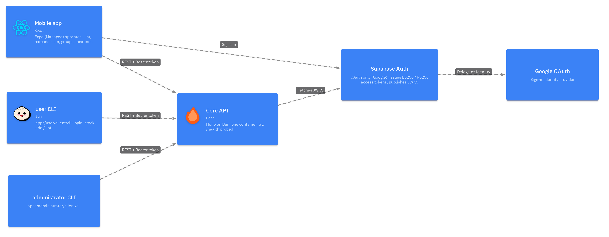
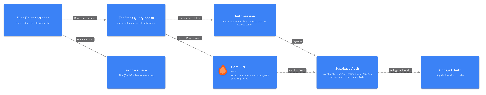

# Architecture

The model is written once in LikeC4 (`spec.c4`, `model.c4`, `views.c4`) and every diagram below is a view projected from it. Change the model, then regenerate the PNGs.

## System landscape


- Actors, devices (Android device, user machine, operator machine), the Coolify host and the managed services (Supabase in the Tokyo region, Google OAuth, Expo push, FCM)
- Hosts are deployment nodes, so they are drawn as boxes around the processes that run on them; there is no system boundary box
- Dashed boxes are planned and not implemented yet (administrator web)
- The Yahoo! Shopping API call is shown in the Core API view, where the `jan-api` package makes it

## Clients and sign-in



- The mobile app signs in with Supabase Auth (Google) and calls the API with the access token; the user CLI and the administrator CLI call the same API
- Mobile and both CLIs share the `@prep-hamster/api-client` package

## Core API internals


- Auth middleware verifies the Supabase access token with JWKS, then routes validate with Zod and query Postgres through Drizzle
- Shared packages (`schema`, `db`, `jan-api`); `sync` is planned and not drawn

## Mobile app



- Screens, TanStack Query hooks, the auth session and the barcode camera, and what each one talks to

## Expiry notification


- A one-shot job reads expiring stock from Postgres and sends push messages through Expo push and FCM to the device
- The scheduling host is not defined in the repo yet (see #134), so the job is not placed on any host in the model

## Regenerate

Run from the repository root. LikeC4 is pinned and not a dependency of the workspace.

```bash
bunx likec4@1.60.0 validate docs/architecture
PLAYWRIGHT_CHROMIUM_USE_HEADLESS_NEW=1 bunx likec4@1.60.0 export png --flat -o docs/architecture docs/architecture
rm -f docs/architecture/index.png
for f in docs/architecture/*.png; do magick "$f" -background white -alpha remove -alpha off "$f"; done
```

- LikeC4 has no background option for PNG export (it writes a transparent background), so the last step flattens the PNGs onto white with ImageMagick; without it they turn black in dark viewers
- PNG export needs Chromium: `bunx playwright install chromium` (on an OS Playwright does not support, set `PLAYWRIGHT_HOST_PLATFORM_OVERRIDE=ubuntu24.04-x64`)
- Open an interactive version with `bunx likec4@1.60.0 start docs/architecture`
