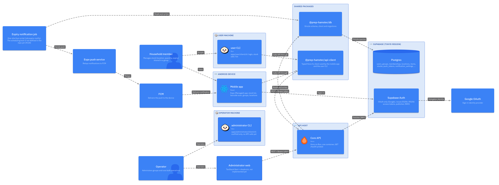

# Architecture

The model is written once in LikeC4 (`spec.c4`, `model.c4`, `views.c4`) and every diagram below is a view projected from it. Change the model, then regenerate the PNGs and commit them in the same change; nothing checks that they match.

## System landscape



- Actors, devices (Android device, user machine, operator machine), the API host and the managed services (Supabase in the Tokyo region, Google OAuth, Expo push, FCM)
- Hosts are deployment nodes, so they are drawn as boxes around the processes that run on them; there is no system boundary box
- Dashed boxes are planned or scaffold only: administrator web and the administrator CLI (it has no API calls yet)
- The Yahoo! Shopping API call is shown in the Core API view, where the `jan-api` package makes it

## Clients and sign-in


- The mobile app signs in with Supabase Auth (Google); the mobile app and the user CLI call the API through the `@prep-hamster/api-client` package
- Administrator web is planned and would call the same API

## Core API internals


- Auth middleware verifies the Supabase access token with JWKS and creates the `users` row on the first request; routes validate with Zod
- All Postgres access goes through `@prep-hamster/db` (Drizzle); `jan-api` calls the Yahoo! Shopping API
- `sync` is planned and not drawn

## Mobile app


- Screens, TanStack Query hooks, the auth session and the barcode camera, and what each one talks to

## Expiry notification


- A one-shot job reads expiring stock and push tokens through `@prep-hamster/db`, sends push messages through Expo push and FCM, and deletes tokens whose ticket says `DeviceNotRegistered`
- The scheduling host is not defined in the repo yet (see #134), so the job is not placed on any host in the model

## Scope

- The model covers the deployed runtime, not the local development stack (`compose.yaml` and `bunx supabase start`)
- The API host is not named: the repo names Cloud Run as the intended target and does not state the current production host
- Only Android and FCM are modeled; iOS (APNs) is out of the first release

## Regenerate

Run from the repository root. LikeC4 is pinned and not a dependency of the workspace. It needs ImageMagick (`magick`, ImageMagick 7) and the Chromium build of the Playwright version LikeC4 bundles (1.64.0 for LikeC4 1.60.0).

```bash
bunx playwright@1.64.0 install chromium
bunx likec4@1.60.0 validate docs/architecture
PLAYWRIGHT_CHROMIUM_USE_HEADLESS_NEW=1 bunx likec4@1.60.0 export png --flat -o docs/architecture docs/architecture
rm -f docs/architecture/index.png
for f in docs/architecture/*.png; do magick "$f" -background white -alpha remove -alpha off "$f"; done
```

- On an OS Playwright does not support, set `PLAYWRIGHT_HOST_PLATFORM_OVERRIDE=ubuntu24.04-x64` for the install
- LikeC4 has no background option for PNG export (it writes a transparent background), so the last step flattens the PNGs onto white; without it they turn black in dark viewers
- Open an interactive version with `bunx likec4@1.60.0 start docs/architecture`
