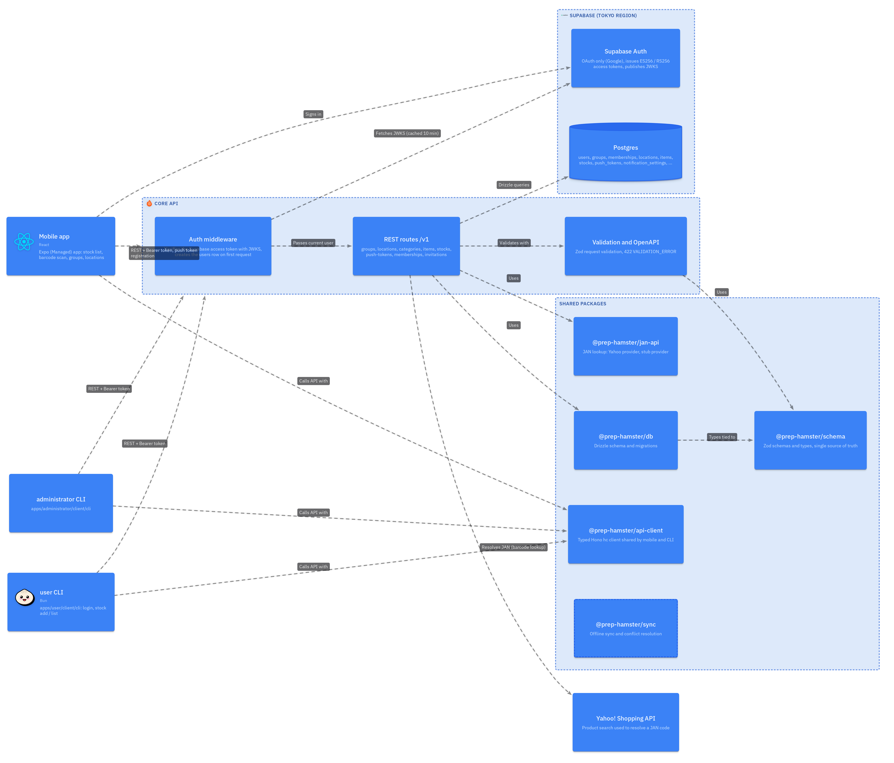
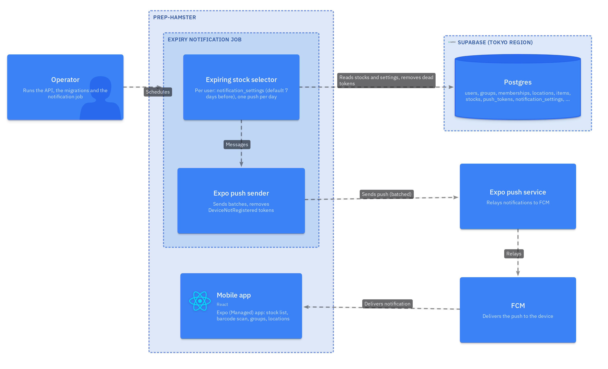

# Architecture

The model is written once in LikeC4 (`spec.c4`, `model.c4`, `views.c4`) and every diagram below is a view projected from it. Change the model, then regenerate the PNGs.

## System landscape


- Clients, the Coolify host and the managed services (Supabase in the Tokyo region, Google OAuth, Yahoo! Shopping API, Expo push, FCM)
- Dashed boxes are planned and not implemented yet (administrator web)

## Core API



- Auth middleware verifies the Supabase access token with JWKS, then routes validate with Zod and query Postgres through Drizzle
- Shared packages (`schema`, `db`, `api-client`, `jan-api`) and the planned `sync` package

## Mobile app


- Screens, TanStack Query hooks, the auth session and the barcode camera, and what each one talks to

## Expiry notification and data



- A one-shot job reads expiring stock from Postgres and sends push messages through Expo push and FCM to the device

## Regenerate

Run from the repository root. LikeC4 is pinned and not a dependency of the workspace.

```bash
bunx likec4@1.60.0 validate docs/architecture
PLAYWRIGHT_CHROMIUM_USE_HEADLESS_NEW=1 bunx likec4@1.60.0 export png --flat -o docs/architecture docs/architecture
rm -f docs/architecture/index.png
```

- PNG export needs Chromium: `bunx playwright install chromium` (on an OS Playwright does not support, set `PLAYWRIGHT_HOST_PLATFORM_OVERRIDE=ubuntu24.04-x64`)
- Open an interactive version with `bunx likec4@1.60.0 start docs/architecture`
