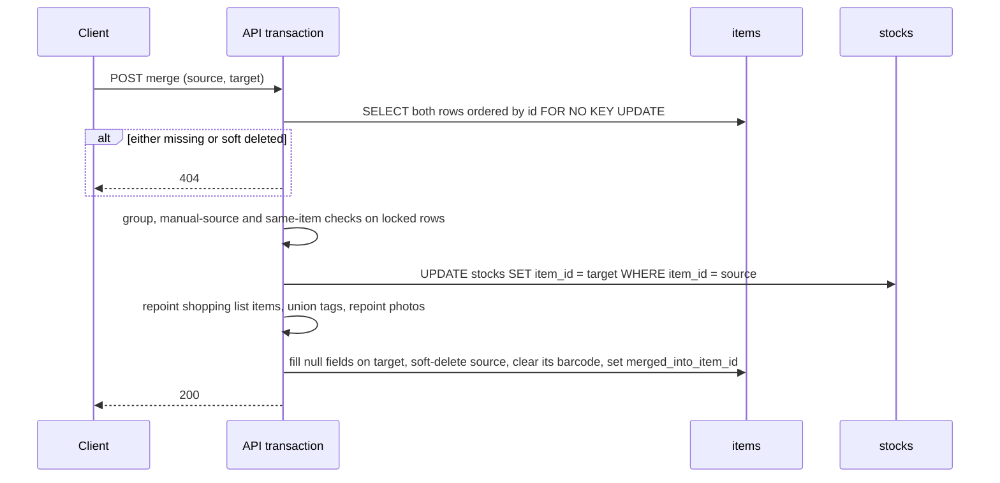

# Merge manually created items that are the same product (#212)

Status: proposal. Names of routes, request keys, columns and error codes below are proposals; each is listed under "Open decisions" and none is final.

## To-Be

- A user who entered the same product by hand twice (no barcode, so two separate items) can fold one into the other. All stocks hanging off the duplicate move to the surviving item, and the duplicate disappears
- Stocks are not summed. Each stock keeps its own quantity, location and dates (two lots with different expiry dates stay two lots). The issue says "reattach the stocks to the destination item", not "combine them"
- Operations the user performs:
  1. Open the stock detail of a manually created item (an item with no product master)
  2. Tap "merge with another product". The screen lists other manually created items of the group; items whose normalized name equals this one are listed first and marked as likely duplicates
  3. Pick the product to keep (the destination) and confirm. A confirmation dialog states which product disappears, how many stocks move, and that this cannot be undone from the app
  4. The screen now shows the destination product; the stock list shows all the stocks under the destination name
- What the user sees:
  - The destination item keeps its name; the other name no longer appears anywhere
  - The dialog count of moved stocks, and the same count in the success message
- Not in scope: undo, merging items that came from a product master (barcode lookup hit), combining stock rows with equal location and dates, an items list screen (the app has none; items are reached through their stocks)

## Data model changes

- Which items can be merged: the source must be manually created (`product_master_id IS NULL`). The destination can be any active item of the same group, including one with a product master, since folding a hand-typed duplicate into a scanned item is the common case. Two product-master items cannot be duplicates (`items_group_product_master_idx` already forbids two items for one master in a group)
- Item fields on merge: the destination's values win; its null `category_id`, `default_unit`, `manufacturer` and `memo` are filled from the source when the source has a value. `name` and `barcode` are never taken from the source
- Finding: `items_group_barcode_idx` is a unique index on `(group_id, barcode)` where `product_master_id IS NULL AND barcode IS NOT NULL`, and it does not filter `deleted_at`. A soft-deleted item keeps holding its barcode in that index. Consequences for merge:
  - the merged-away source keeps its barcode and keeps blocking that barcode in the group (same as today after an item delete)
  - the destination does not receive the source's barcode (copying it would violate the index while the source row still holds it)
  - a later scan of that barcode does not find the soft-deleted source (`POST /v1/items/by-barcode` filters `deleted_at IS NULL`), and creating a new item with that barcode hits the unique index and fails with `ITEM_BARCODE_DUPLICATE`. This is an existing weakness of item soft delete, made reachable by merge. The proposal clears the source's barcode as part of the merge so that the barcode is free again
- Proposal: add `merged_into_item_id uuid null` (fk items) on `items`, set on the soft-deleted source. It records where stocks went, so support lookups ("where did this product go") do not need the event log. No `item_merges` history table
- Rows repointed to the destination, inside the merge transaction:
  - `stocks.item_id` for every stock of the source, including soft-deleted ones (so no row, active or not, references a soft-deleted merged item)
  - `shopping_list_items.item_id` (the table exists, no route uses it yet; repointing keeps v1.2.0 from inheriting dangling references)
  - tags (#210): union of both items' `item_tags`, source rows deleted
  - photos (#213): `item_photos.item_id` repointed; storage objects do not move, because the object path in that design does not contain the item id
- `stock_events` reference stocks, not items, so they need no change

## API changes

Proposed route (name pending): `POST /v1/items/{id}/merge` where `{id}` is the source.

Request:

```json
{ "targetItemId": "uuid of the item to keep" }
```

Response 200:

```json
{ "item": "the destination item", "movedStocks": 3 }
```

- Roles: EDITOR or higher on the group
- Read helper for the picker: the existing `GET /v1/items?groupId=` is enough (it returns every item of the group). Duplicate hints are computed on the client by normalized name; no new endpoint in the first version
- `movedStocks` counts rows repointed (active and soft-deleted). The count shown in the confirmation dialog before the call is the number of active stocks, from the stock list the screen already holds. The two numbers can differ by the soft-deleted rows, which the dialog does not mention

Errors, existing codes reused where the meaning is the same:

| Status | Code | When |
| --- | --- | --- |
| 404 | NOT_FOUND | source or destination missing, soft deleted, or deleted during the request |
| 403 | existing group-access codes | not a member or VIEWER |
| 422 | VALIDATION_ERROR | `targetItemId` missing or not a guid |
| 422 | ITEM_GROUP_MISMATCH | source and destination are in different groups (existing code used by stock create) |
| 422 | ITEM_MERGE_SAME_ITEM (proposed) | source equals destination |
| 422 | ITEM_MERGE_SOURCE_NOT_MANUAL (proposed) | the source has a product master |

Replay: the second identical call finds the source soft-deleted and returns 404 NOT_FOUND. A client that lost the response of the first call cannot tell "done" from "never existed". Proposal: a call whose source is already merged into the same destination returns 200 with `movedStocks: 0` (readable through `merged_into_item_id`), which makes retries idempotent without a client-supplied key.

## Mobile screens touched

- `app/stocks/[id].tsx`: a "merge with another product" row under the item name, shown for items without a product master. Candidate list and merge call in a new pure module (`src/item-merge.ts`), tested without rendering, same split as `location-manage.ts`
- The picker is a modal list (same pattern as the location manager modal in #171)
- After success, navigate to the stock detail of the first moved stock if the open stock moved, or refresh in place; both screens already refetch on focus
- The entry point is a decision below (the app has no items screen)

## Migration and RLS

- One migration: add `items.merged_into_item_id` (nullable, fk to items)
- No new table, so no new RLS statement; the every-table-has-RLS e2e check is unchanged
- Existing rows: null; no backfill

## Concurrency

Pattern from #192 and PR #219: rows are locked inside the transaction and every decision is made on locked values; lock order is fixed.



- Both item rows are locked in id order, so two merges in opposite directions (A into B and B into A) cannot deadlock; the second finds its source already soft-deleted and returns 404
- The race that matters: stock creation checks the item outside any transaction (`createStockRoute` reads the item, then inserts). A stock created between the merge's repoint and its soft delete would reference the merged-away item. The same read-then-write shape is what #220 reports for location delete and what item delete does today (`ITEM_IN_USE` check outside a transaction). Proposal: stock create takes `FOR SHARE` on the item row inside its transaction and re-checks `deleted_at`. `FOR SHARE` conflicts with the merge's `FOR NO KEY UPDATE`, so a create either completes first (and its stock is repointed by the merge) or sees the soft-deleted item and returns 422 ITEM_GROUP_MISMATCH. This is a change to stock create, in scope for this feature, and it also closes the item-delete variant of the race if item delete takes the same lock (decision below)
- Concurrent consume, discard, move on a source stock: the repoint UPDATE waits for the row lock and then rewrites only `item_id`; consume and move do not read the item
- Concurrent tag PUT or photo upload for the source item: those lock the item row first (`FOR NO KEY UPDATE`, see their docs), so they serialize with the merge; after the merge they find the source soft-deleted and return 404

## Tests

- API e2e (`items-merge.test.ts`, concurrency additions in `stocks-concurrency.test.ts` style with `lock-helper.ts`):
  1. merge moves active and soft-deleted stocks, source is soft-deleted with `merged_into_item_id`, barcode freed, destination null fields filled and non-null fields kept
  2. stocks keep their own quantity, location and dates (no summing)
  3. 422 for same item, cross-group, source with product master; 403 for VIEWER; 404 for missing
  4. replay returns 200 with `movedStocks: 0`
  5. races: merge against stock create (stock ends up on the destination or the create fails, never on the source); two opposite merges (one 200, one 404); merge against a consume on a moved stock
- Unit: candidate ordering by normalized name (NFKC, case-fold, whitespace removed), merge result handling
- Maestro: `item-merge.yaml` (add two manual stocks with the same name using the existing `add-unique-stock` subflow naming, merge, assert one product name remains in the list)
- Negative control per branch: manual-source check, group check, same-item check, null-field fill precedence, the item lock

## Dependencies

- #186 (quantities as `real`): merge never adds or subtracts quantities, so it does not depend on the numeric versus real decision. It would, only if the optional follow-up "combine stocks with equal location and dates" is taken (listed as out of scope); that would sum `real` values and must wait for #186
- #210 (tags) and #213 (photos): the merge transaction handles their rows as described; whichever lands later adds its repoint to the merge
- #220: the stock-create lock proposed here overlaps its scope; the fixes should be coordinated, not duplicated

## Open decisions

### D-merge-scope. Which items can be the source

- Question: may an item with a product master be the source of a merge?
- Options: source must be manual (no product master), destination any; both must be manual; any item into any item
- Recommendation: source must be manual, destination any
- Reason: the issue is about hand-typed duplicates; an item with a product master is anchored to a JAN record and a unique index, so it should be the one that stays

### D-merge-barcode. Barcode of the merged-away item

- Question: what happens to the source's barcode?
- Options: clear it on the source (barcode becomes free); keep it on the source and leave it blocking; copy it to the destination
- Recommendation: clear it on the source
- Reason: the unique index ignores `deleted_at`, so keeping it blocks a later scan with `ITEM_BARCODE_DUPLICATE`; copying violates the index while the source row still exists

### D-merge-column. Recording where the stocks went

- Question: is the merge recorded and how?
- Options: nullable `items.merged_into_item_id`; a separate `item_merges` table; no record
- Recommendation: `items.merged_into_item_id`
- Reason: it makes replays answerable and supports "where did it go" without a new table (and a new table would need its own RLS statement); the name needs the user's confirmation as a new column

### D-merge-route. Route and request key names

- Question: what are the route path and request key?
- Options: `POST /v1/items/{id}/merge` with `targetItemId`; `POST /v1/items/merge` with `sourceItemId` and `targetItemId`; `PATCH /v1/items/{id}` with a merge key
- Recommendation: `POST /v1/items/{id}/merge` with `targetItemId`
- Reason: it follows the sub-resource action style of `/stocks/{id}/move`; a PATCH key would mix a destructive operation into a plain edit

### D-merge-errors. Error code names

- Question: what are the new error codes?
- Options: `ITEM_MERGE_SAME_ITEM` and `ITEM_MERGE_SOURCE_NOT_MANUAL`; one `ITEM_MERGE_INVALID` with the reason in the message
- Recommendation: two codes
- Reason: clients and tests can branch on them, as on `MOVE_NOOP` and `LOCATION_GROUP_MISMATCH`

### D-merge-replay. Retry of a completed merge

- Question: what does the second identical call return?
- Options: 200 with `movedStocks: 0` when the source was already merged into the same destination; 404 like any soft-deleted item; a client-supplied idempotency key
- Recommendation: 200 with `movedStocks: 0`
- Reason: a client that lost the first response needs to tell "done" from "gone"; the stored `merged_into_item_id` answers it without a key

### D-merge-create-lock. Locking item in stock create

- Question: is stock create changed to lock the item row inside its transaction as part of this feature?
- Options: yes, `FOR SHARE` and re-check in stock create now; leave stock create as is and handle it in #220
- Recommendation: yes, now
- Reason: without it a stock created during a merge can reference the merged-away item; merge cannot be correct without the writer side

### D-merge-entry. Entry point in the app

- Question: where does the user start a merge, given the app has no items screen?
- Options: a row on the stock detail screen; a new items list screen; a long-press action on the stock list
- Recommendation: a row on the stock detail screen
- Reason: no new screen, and the user sees the duplicate through its stock

### D-merge-hints. Duplicate detection

- Question: does the app suggest likely duplicates?
- Options: no suggestion (plain list); client-side normalized-name ordering in the picker; a server endpoint listing duplicate groups
- Recommendation: client-side normalized-name ordering
- Reason: `GET /v1/items` already returns every item; a server endpoint adds an API surface for something the client can sort

### D-merge-stocks. Combining stocks of equal location and dates

- Question: after the merge, are stock rows with the same location and dates combined into one?
- Options: never combine; combine automatically; offer it as a separate action
- Recommendation: never combine
- Reason: the issue only asks for reattaching; combining sums `real` quantities, which depends on the #186 decision, and loses per-lot history
