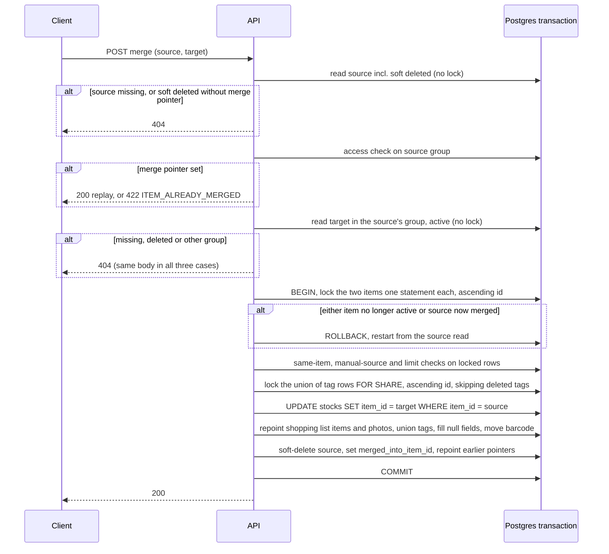

# Merge manually created items that are the same product (#212)

Status: proposal. Names of routes, request keys, columns and error codes below are proposals; each is listed under "Open decisions" and none is final.

## To-Be

- A user who entered the same product by hand twice (no barcode, so two separate items) can fold one into the other. All stocks hanging off the duplicate move to the surviving item, and the duplicate disappears
- Stocks are not summed. Each stock keeps its own quantity, location and dates (two lots with different expiry dates stay two lots). The issue says "reattach the stocks to the destination item", not "combine them"
- Operations the user performs:
  1. Open the stock detail of a manually created item (an item with no product master)
  2. Tap "merge with another product". The screen lists every other active item of the group. Manually created items whose normalized name equals this one are listed first and marked as likely duplicates; the rest follow in the order the API returns them
  3. Pick the product to keep (the destination) and confirm. A confirmation dialog states which product disappears, how many active stocks move, and that this cannot be undone from the app
  4. The screen now shows the destination product; the stock list shows all the stocks under the destination name
- What the user sees:
  - The destination item keeps its name; the other name no longer appears anywhere
  - The dialog count of moved stocks, and the same count in the success message
  - If the merge would push the destination over the tag or photo limit, a message naming which limit and by how much, and nothing changes
- Not in scope: undo, merging items that came from a product master (barcode lookup hit) as the source, combining stock rows with equal location and dates, an items list screen (the app has none; items are reached through their stocks)

## Data model changes

- Which items can be merged: the source must be manually created (`product_master_id IS NULL`). The destination can be any active item of the same group, including one with a product master, since folding a hand-typed duplicate into a scanned item is the common case, which is why the picker lists all active items and not only manual ones. An item with a product master is out of scope as a source because it is anchored to a master record; the index `items_group_product_master_idx` forbids two items for the same master in a group, but two different masters may describe one real product, and this design does not merge those
- Item fields on merge (a product choice, listed as a decision): the destination's values win; its null `category_id`, `default_unit`, `manufacturer` and `memo` are filled from the source when the source has a value. `name` is never taken from the source
- Barcode, assuming #236 (the fix for #235, open as a draft PR): that PR adds `deleted_at IS NULL` to both partial unique indexes on `items` (`items_group_barcode_idx` and `items_group_product_master_idx`). Today the first index ignores `deleted_at`, so a soft-deleted item keeps blocking its barcode
  - With #236 merged, the soft-deleted source no longer holds anything in the unique indexes, so the merge does not need to clear the source's barcode for the index's sake. The merged-away row keeps its barcode as a record of which barcode the duplicate had
  - Scanning that barcode later finds no active item (`POST /v1/items/by-barcode` filters `deleted_at IS NULL`) and would create a new item again, which re-creates the duplicate. So when the destination is manual and has no barcode, the source's barcode is moved to it (the destination's own barcode always wins when it has one, and a destination with a product master keeps its own barcode)
  - Merge ships after #236. Without #236 the transfer would hit the index while the soft-deleted source still holds the barcode (clearing the source's barcode first inside the same transaction would avoid that, but it loses the record)
- Proposal: add `merged_into_item_id uuid null` (fk items) on `items`, set on the soft-deleted source. It records where stocks went, so support lookups do not need the event log. In the same transaction, earlier merged-away items that pointed at the source are repointed to the destination (A merged into B, then B into C, leaves A pointing at C), so there is never a chain to walk. No `item_merges` history table. No actor or timestamp columns: `updated_at` of the source is the merge time and the actor adds nothing to a lookup of where it went
- Rows repointed to the destination, inside the merge transaction:
  - `stocks.item_id` for every stock of the source, including soft-deleted ones (so no row, active or not, references a soft-deleted merged item)
  - `shopping_list_items.item_id` (the table exists, no route uses it yet; repointing keeps v1.2.0 from inheriting dangling references)
  - tags (#210): union of both items' `item_tags`, inserted with conflict ignored (a tag on both items is one row), source rows deleted, deleted tags skipped
  - photos (#213): `item_photos.item_id` repointed; storage objects do not move, because the object path in that design does not contain the item id
- Foreign key inventory: today `items.id` is referenced by `stocks.item_id` and `shopping_list_items.item_id` (`packages/db/src/schema.ts`), plus the tag and photo tables once they exist. Because a missed table would dangle silently, an e2e test queries `pg_constraint` for every foreign key that references `items` and compares the list with the tables the merge repoints; adding a new referencing table fails the test until the merge handles it
- `stock_events` reference stocks, not items, so they need no change

## API changes

Proposed route (name pending): `POST /v1/items/{id}/merge` where `{id}` is the source.

Request:

```json
{ "targetItemId": "uuid of the item to keep" }
```

Response 200:

```json
{ "item": "the destination item", "movedStocks": 3, "movedDeletedStocks": 1 }
```

- Roles: EDITOR or higher on the group of the source
- Read helper for the picker: the existing `GET /v1/items?groupId=` is enough (it returns every item of the group). Duplicate hints are computed on the client by normalized name; no new endpoint in the first version. The normalization is a client-side hint only: NFKC, case-folded, whitespace removed. It is deliberately looser than the identity rule for tag names (`stock-tags.md`: trimmed, NFKC, lower-cased), because a wrong hint costs nothing and a missed duplicate does
- `movedStocks` counts active stocks and `movedDeletedStocks` counts soft-deleted ones that were repointed, so the success message matches the dialog (which shows active stocks only)
- The caller is authorized against the source's group only. The destination is looked up inside that group: a destination that is missing, soft deleted, or in another group gives the same 404 NOT_FOUND with the same message, so the response does not reveal whether a UUID exists in another group. Existing stock create answers 422 ITEM_GROUP_MISMATCH for a foreign item and for a deleted item alike; that existing behavior is unchanged by this design

Errors, existing codes reused where the meaning is the same:

| Status | Code | When |
| --- | --- | --- |
| 404 | NOT_FOUND | source missing or deleted (not by a merge); destination missing, soft deleted or in another group (one message for all three) |
| 403 | existing group-access codes | not a member or VIEWER |
| 422 | VALIDATION_ERROR | `targetItemId` missing or not a guid |
| 422 | ITEM_MERGE_SAME_ITEM (proposed) | source equals destination |
| 422 | ITEM_MERGE_SOURCE_NOT_MANUAL (proposed) | the source has a product master |
| 422 | ITEM_MERGE_LIMIT_EXCEEDED (proposed) | the union of tags or the sum of photos would exceed the per-item limit of the destination |
| 422 | ITEM_ALREADY_MERGED (proposed) | the source was already merged into a different item |

Replay: the handler reads the source row including soft-deleted rows before treating a soft-deleted source as missing. A source that carries `merged_into_item_id` equal to the requested destination returns 200 with `movedStocks: 0` and `movedDeletedStocks: 0` (the destination is read as it is now). A source merged into a different item returns 422 ITEM_ALREADY_MERGED. Because earlier pointers are repointed on every later merge, "already merged into B" is judged against the current destination, so a retry of A into B after B was merged into C gets ITEM_ALREADY_MERGED. A soft-deleted source with no merge pointer (deleted the ordinary way) is 404.

## Mobile screens touched

- `app/stocks/[id].tsx`: a "merge with another product" row under the item name, shown for items without a product master. Candidate list and merge call in a new pure module (`src/item-merge.ts`), tested without rendering, same split as `location-manage.ts`
- The picker is a modal list (same pattern as the location manager modal in #171) showing all active items of the group, likely duplicates first
- After success, navigate to the stock detail of the first moved stock if the open stock moved, or refresh in place; both screens already refetch on focus
- The entry point is a decision below (the app has no items screen)

## Migration and RLS

- One migration: add `items.merged_into_item_id` (nullable, fk to items)
- No new table, so no new RLS statement; the every-table-has-RLS e2e check is unchanged
- Existing rows: null; no backfill
- Depends on the #236 migration for the index change

## Concurrency

Pattern from #192 and PR #219: rows are locked inside the transaction and every decision is made on locked values. Global lock order for features that touch items, stocks, locations and tags (the same text is in `stock-tags.md` and `stock-split.md`): item rows (ascending id), then stock rows, then location rows, then tag rows (ascending id). Rows of one kind are locked with one `SELECT ... FOR ...` statement per row after sorting the ids in application code.



- Why `FOR NO KEY UPDATE` on items is the right lock for merge: every transaction that inserts a `stocks` row (stock create and split, see `stock-split.md`) holds `FOR SHARE` on its item before inserting, and per Postgres, Explicit Locking, Table 13.3, FOR SHARE conflicts with FOR NO KEY UPDATE. The foreign key check alone would not do: it takes the weaker key-share lock, which does not conflict with FOR NO KEY UPDATE. The repoint `UPDATE stocks` runs as a statement after the locks are held, so in READ COMMITTED its snapshot sees every stock that committed before the merge's lock. A stock insert that starts later waits for the merge and then finds the item soft deleted. Neither stock create nor split can leave an active stock on the merged-away item
- Two merges in opposite directions, A into B and B into A: both lock the same two items in ascending id order, so they cannot deadlock. The second one to get the locks finds its destination (the first one's source) soft deleted and restarts, then answers 404 because the destination is gone
- Concurrent consume, discard, move on a source stock: the repoint waits for their row locks and rewrites only `item_id`; they take no item lock and do not read the item
- Tag writers: PUT of an item's tags locks the item row first, so it serializes with the merge on the same item. Tag delete locks the tag row `FOR NO KEY UPDATE`; the merge locks every tag it will write `FOR SHARE`, which conflicts with it. So a tag delete cannot commit between the merge's read of the union and its insert and leave an `item_tags` row for a deleted tag. The merge reads tag state after taking those locks and skips tags that are deleted
- Photo upload for the source or destination locks the item row first, so it serializes with the merge; after the merge it finds the source soft deleted and answers 404
- Item delete currently checks stock references outside a transaction (same shape as #220). It is not changed by this design; taking the item lock there is a follow-up (decision below)

## Tests

- API e2e (`items-merge.test.ts`, concurrency additions in the style of `stocks-concurrency.test.ts` with `lock-helper.ts`):
  1. merge moves active and soft-deleted stocks, source is soft-deleted with `merged_into_item_id`, destination null fields filled and non-null fields kept; `movedStocks` and `movedDeletedStocks` match the fixture
  2. stocks keep their own quantity, location and dates (no summing)
  3. barcode (after #236): a manual destination without barcode receives the source's barcode and a later by-barcode call returns the destination; a destination with its own barcode keeps it; the source row keeps its barcode
  4. 422 for same item and for a source with a product master; 403 for VIEWER; 404 for a missing source
  5. cross-group probing: a destination that exists in another group and a destination that does not exist return byte-identical 404 bodies
  6. replay: same request again returns 200 with zero counts; a different destination returns 422 ITEM_ALREADY_MERGED; A into B, then B into C, then A into B again returns 422 ITEM_ALREADY_MERGED and A's pointer is C (no chain)
  7. tags: overlapping tags become one row; a union over the cap returns 422 ITEM_MERGE_LIMIT_EXCEEDED and nothing changes; photos likewise
  8. foreign key inventory test against `pg_constraint`
  9. races: merge against stock create (the stock ends on the destination or the create fails, never on the source); merge against split (see `stock-split.md` test 7); two opposite merges (one 200, one 404); merge against a consume on a moved stock; merge against a tag delete of a tag on the source (no `item_tags` row for the deleted tag)
- Unit: candidate ordering by normalized name (NFKC, case-fold, whitespace removed), merge result handling
- Maestro: `item-merge.yaml` (add two manual stocks with the same name using the existing `add-unique-stock` subflow, merge, assert one product name remains in the list)
- Negative control per branch: manual-source check, destination lookup scoped to the group, same-item check, null-field fill precedence, barcode transfer precedence, replay-versus-error decision, the item locks, the tag locks, the limit check

## Dependencies

- #236 (soft-deleted items release their barcode and master): the barcode design above assumes it
- #186 (quantities as `real`): merge never adds or subtracts quantities, so it does not depend on the numeric versus real decision. It would, only if the optional follow-up "combine stocks with equal location and dates" is taken (listed as out of scope); that would sum `real` values and must wait for #186
- #210 (tags) and #213 (photos): the merge transaction handles their rows as described and enforces their limits; whichever lands later adds its repoint to the merge
- #211 (split): split takes part in the item lock protocol above
- #220: the lock protocol overlaps its scope (read-then-write checks outside the transaction); the fixes should be coordinated, not duplicated

## Open decisions

### D-merge-scope. Which items can be the source

- Question: may an item with a product master be the source of a merge?
- Options: source must be manual (no product master), destination any; both must be manual; any item into any item
- Recommendation: source must be manual, destination any
- Reason: the issue is about hand-typed duplicates; an item with a product master is anchored to a JAN record, so it should be the one that stays. The picker lists all active items so that the common case (folding into a scanned item) is reachable

### D-merge-barcode. Barcode of the merged-away item (changed)

- Question: what happens to the source's barcode, given #236 makes soft-deleted items release their barcode?
- Options:
  1. Move it to the destination when the destination is manual and has none; the source row keeps it as a record
  2. Leave it on the soft-deleted source and do not carry it over
  3. Clear it on the source
- Recommendation: option 1 (changed; the first revision recommended clearing it for the index's sake, a reason #236 removes)
- Reason: with option 2 or 3 a later scan of that barcode creates a fresh item and brings the duplicate back. Option 1 depends on #236, so merge ships after it

### D-merge-column. Recording where the stocks went (changed)

- Question: is the merge recorded and how?
- Options: nullable `items.merged_into_item_id` with earlier pointers repointed at each later merge; the same column without repointing (chains); a separate `item_merges` table; no record
- Recommendation: the column, with earlier pointers repointed
- Reason: it makes replays answerable and lookups one hop without a new table (a new table would need its own RLS statement). The name needs the user's confirmation as a new column

### D-merge-route. Route and request key names (changed)

- Question: what are the route path, request key and response keys?
- Options: `POST /v1/items/{id}/merge` with `targetItemId`, response `item`, `movedStocks`, `movedDeletedStocks`; `POST /v1/items/merge` with `sourceItemId` and `targetItemId`; `PATCH /v1/items/{id}` with a merge key
- Recommendation: `POST /v1/items/{id}/merge` with `targetItemId`; response `item`, `movedStocks`, `movedDeletedStocks`
- Reason: it follows the sub-resource action style of `/stocks/{id}/move`; a PATCH key would mix a destructive operation into a plain edit. Two counts keep the success message equal to the dialog

### D-merge-errors. Error code names (changed)

- Question: what are the new error codes?
- Options: `ITEM_MERGE_SAME_ITEM`, `ITEM_MERGE_SOURCE_NOT_MANUAL`, `ITEM_MERGE_LIMIT_EXCEEDED`, `ITEM_ALREADY_MERGED`; fewer codes with the reason in the message
- Recommendation: the four codes
- Reason: clients and tests can branch on them, as on `MOVE_NOOP` and `LOCATION_GROUP_MISMATCH`. `ITEM_GROUP_MISMATCH` is not used by merge (a foreign destination is a plain 404)

### D-merge-replay. Retry of a completed merge (changed)

- Question: what does a repeated request return after the merge succeeded?
- Options:
  1. Same destination: 200 with zero counts; a different destination: 422 `ITEM_ALREADY_MERGED`
  2. 404 like any soft-deleted item
  3. A client-supplied idempotency key
- Recommendation: option 1
- Reason: a client that lost the first response needs to tell "done" from "gone"; the stored pointer answers it without a key, and the different-destination case now has a defined answer

### D-merge-caps. Per-item limits when merging (new)

- Question: what happens when the merged tags or photos would exceed the per-item limits of #210 and #213?
- Options: block the merge with a 422 that names the limit; allow the overflow (limits apply only to new attachments); trim the surplus
- Recommendation: block the merge with a 422
- Reason: allowing overflow leaves items whose every later tag edit or photo upload is rejected for a reason the user did not cause; trimming silently deletes user data. The user can remove tags or photos and merge again

### D-merge-fields. Which item values survive (new)

- Question: when both items have a value, which one is kept?
- Options: the destination's value always wins and its empty fields are filled from the source; the destination's value wins and nothing is filled; the user picks field by field in the dialog
- Recommendation: the destination's value wins and its empty fields are filled from the source
- Reason: the user already chose the destination by choosing what to keep, and filling empty fields loses nothing; a per-field dialog adds a screen for four rarely-set fields

### D-merge-create-lock. Which writers take the item lock (changed)

- Question: which stock writers take the item lock inside their transaction as part of this feature?
- Options: stock create and split; stock create, split and item delete; none (leave it all to #220)
- Recommendation: stock create and split now; item delete as a follow-up issue
- Reason: merge is not correct unless every writer that inserts a stock holds the lock (the first revision covered only create and missed split). Item delete has the same read-then-write shape but is a separate fix

### D-merge-entry. Entry point in the app

- Question: where does the user start a merge, given the app has no items screen?
- Options: a row on the stock detail screen; a new items list screen; a long-press action on the stock list
- Recommendation: a row on the stock detail screen
- Reason: no new screen, and the user sees the duplicate through its stock

### D-merge-hints. Duplicate detection

- Question: does the app suggest likely duplicates?
- Options: no suggestion (plain list); client-side normalized-name ordering in the picker; a server endpoint listing duplicate groups
- Recommendation: client-side normalized-name ordering
- Reason: `GET /v1/items` already returns every item; a server endpoint adds an API surface for something the client can sort

### D-merge-stocks. Combining stocks of equal location and dates

- Question: after the merge, are stock rows with the same location and dates combined into one?
- Options: never combine; combine automatically; offer it as a separate action
- Recommendation: never combine
- Reason: the issue only asks for reattaching; combining sums `real` quantities, which depends on the #186 decision, and loses per-lot history
