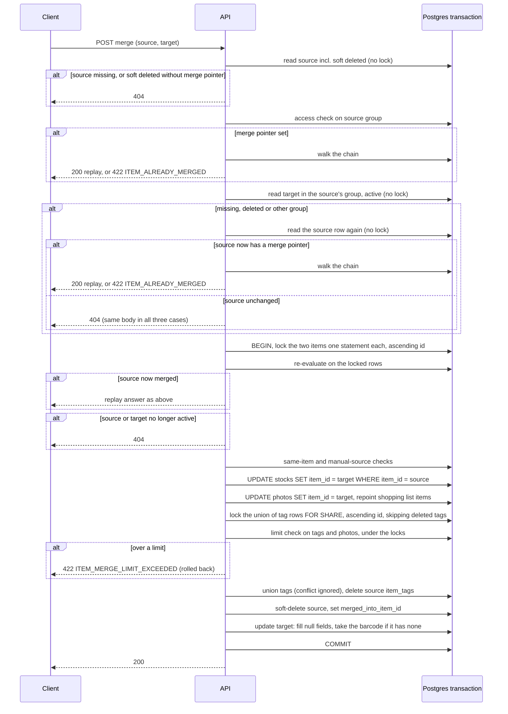

# Merge manually created items that are the same product (#212)

Status: proposal. Names of routes, request keys, columns and error codes below are proposals; each is listed under "Open decisions" and none is final.

## To-Be

- A user who entered the same product by hand twice (no barcode, so two separate items) can fold one into the other. All stocks hanging off the duplicate move to the surviving item, and the duplicate disappears
- Stocks are not summed. Each stock keeps its own quantity, location and dates (two lots with different expiry dates stay two lots). The issue says "reattach the stocks to the destination item", not "combine them"
- Operations the user performs:
  1. Open the stock detail of a manually created item (an item with no product master)
  2. Tap "merge with another product". The screen lists every other active item of the group. Manually created items whose normalized name equals this one are listed first and marked as likely duplicates; the rest follow in the order the API returns them
  3. Pick the product to keep (the destination) and confirm. A confirmation dialog states which product disappears, how many active stocks move, and that this cannot be undone from the app
  4. The screen now shows the destination product; the stock list shows all the stocks under the destination name
- What the user sees:
  - The destination item keeps its name; the other name no longer appears anywhere
  - The dialog count of moved stocks, and the same count in the success message
  - If the merge would push the destination over the tag or photo limit, a message naming which limit and by how much, and nothing changes
  - Accepted limit: an item has one barcode. If the destination already has its own barcode, the source's barcode stays only on the merged-away row, so scanning it later creates a new item again. The user can merge that new item the same way. Carrying several barcodes per item (an alias table) is out of scope
- Not in scope: undo, merging items that came from a product master (barcode lookup hit) as the source, combining stock rows with equal location and dates, an items list screen (the app has none; items are reached through their stocks)

## Data model changes

- Which items can be merged: the source must be manually created (`product_master_id IS NULL`). The destination can be any active item of the same group, including one with a product master, since folding a hand-typed duplicate into a scanned item is the common case, which is why the picker lists all active items and not only manual ones. An item with a product master is out of scope as a source because it is anchored to a master record; the index `items_group_product_master_idx` forbids two items for the same master in a group, but two different masters may describe one real product, and this design does not merge those
- Item fields on merge (a product choice, listed as a decision): the destination's values win; its null `category_id`, `default_unit`, `manufacturer` and `memo` are filled from the source when the source has a value. `name` is never taken from the source
- Barcode, assuming #236 (the fix for #235, open as a draft PR): that PR adds `deleted_at IS NULL` to both partial unique indexes on `items` (`items_group_barcode_idx` and `items_group_product_master_idx`). Today the first index ignores `deleted_at`, so a soft-deleted item keeps blocking its barcode
  - With #236 merged, the soft-deleted source no longer holds anything in the unique indexes, so the merge does not need to clear the source's barcode for the index's sake. The merged-away row keeps its barcode as a record of which barcode the duplicate had
  - Scanning that barcode later finds no active item (`POST /v1/items/by-barcode` filters `deleted_at IS NULL`) and would create a new item again, which re-creates the duplicate. So when the destination has no barcode, the source's barcode is moved to it; when the destination has its own barcode it wins (see the accepted limit in To-Be). The condition is "the destination has no barcode", not "the destination is manual": items created by the barcode route always carry a barcode (`items.barcode` is set on both the hit and miss insert), so a destination with a product master and no barcode can only appear after a PATCH that nulled it, and then it receives the source's barcode like any other. The partial unique index only covers items without a product master, so a destination with a master cannot collide
  - Statement order inside the merge transaction matters: the source is soft-deleted first, then the destination is updated (fields and barcode). With #236's index (`deleted_at IS NULL` in the predicate) the soft-deleted source is out of the index by the time the destination takes the barcode; updating the destination first would collide with the still-active source row. A test pins this order
  - Merge ships after #236. Without #236 the transfer would hit the index while the soft-deleted source still holds the barcode (clearing the source's barcode first inside the same transaction would avoid that, but it loses the record)
- Proposal: add `merged_into_item_id uuid null` (fk items, `ON DELETE SET NULL` so the physical purge of old soft-deleted items after 90 days does not fail on pointers from other merged items) on `items`, set on the soft-deleted source. It records where stocks went, so support lookups do not need the event log. Pointers are not flattened: A merged into B and then B into C leaves A pointing at B and B pointing at C. The chain cannot cycle, because a pointer is set only on an item that is being soft-deleted and an item can only be merged away once (the source must be active). Lookups and replay walk the chain; its length is the number of merges in a row on one product, a handful. No index on the column: the walk follows primary keys and nothing filters by it. No `item_merges` history table. No actor or timestamp columns: `updated_at` of the source is the merge time and the actor adds nothing to a lookup of where it went
- Merged-away items are not restorable. If a trash or restore feature for items is ever built (`docs/stock/operational-policy.md` section 1.1 mentions a possible one), it must refuse items that have `merged_into_item_id` set, because restoring one would bring back a duplicate with no stocks
- Rows repointed to the destination, inside the merge transaction:
  - `stocks.item_id` for every stock of the source, including soft-deleted ones (so no row, active or not, references a soft-deleted merged item)
  - `shopping_list_items.item_id` (the table exists in `packages/db/src/schema.ts` with no route using it yet, and it has no unique constraint or index on `item_id`, checked in the schema, so a plain repoint cannot collide; repointing keeps v1.2.0 from inheriting dangling references)
  - tags (#210): union of both items' `item_tags`, inserted with conflict ignored (a tag on both items is one row), source rows deleted, deleted tags skipped. `item_tags` has no `deleted_at`, so the tag limit counts rows whose tag is active
  - photos (#213): `item_photos.item_id` repointed for every photo of the source, including soft-deleted ones (same reason as stocks); the photo limit counts active photos only, because `item_photos` has `deleted_at`. Storage objects do not move, because the object path in that design does not contain the item id
  - `items.merged_into_item_id` is itself a foreign key to `items`; it is not repointed (see the chain above), and the inventory test below lists it as handled
- Foreign key inventory: today `items.id` is referenced by `stocks.item_id` and `shopping_list_items.item_id` (`packages/db/src/schema.ts`), plus the tag and photo tables and the new self reference once they exist. Because a missed table would dangle silently, an e2e test queries `pg_constraint` for every foreign key that references `items` and compares the list with the tables the merge repoints; adding a new referencing table fails the test until the merge handles it. The test sees foreign keys only; a column that holds an item id without a foreign key would not be caught, and none exists today (checked by searching the schema for item id columns)
- `stock_events` reference stocks, not items, so they need no change

## API changes

Proposed route (name pending): `POST /v1/items/{id}/merge` where `{id}` is the source.

Request:

```json
{ "targetItemId": "uuid of the item to keep" }
```

Response 200:

```json
{ "item": "the destination item", "movedStocks": 3, "movedDeletedStocks": 1 }
```

- Roles: EDITOR or higher on the group of the source
- Read helper for the picker: the existing `GET /v1/items?groupId=` is enough (it returns every item of the group). Duplicate hints are computed on the client by normalized name; no new endpoint in the first version. The normalization is a client-side hint only: NFKC, case-folded, whitespace removed. It is deliberately looser than the identity rule for tag names (`stock-tags.md`: trimmed, NFKC, lower-cased), because a wrong hint costs nothing and a missed duplicate does
- `movedStocks` counts active stocks and `movedDeletedStocks` counts soft-deleted ones that were repointed, so the success message matches the dialog (which shows active stocks only)
- Existence policy used by all four designs: an id that the client puts in a request body is looked up inside the caller's group, and a missing, deleted or other-group id gets one and the same answer, so the response does not reveal whether a UUID exists in another group. Here: the destination (`targetItemId`) is looked up inside the source's group and gets one 404 NOT_FOUND with one message in all three cases. Ids in the URL path keep the behavior of the existing routes (404 when missing, then the membership check), and so do the existing routes themselves (stock create answers 422 ITEM_GROUP_MISMATCH for a foreign item and for a deleted item alike); this design does not change those

Errors, existing codes reused where the meaning is the same:

| Status | Code                                    | When                                                                                                                          |
| ------ | --------------------------------------- | ----------------------------------------------------------------------------------------------------------------------------- |
| 404    | NOT_FOUND                               | source missing or deleted (not by a merge); destination missing, soft deleted or in another group (one message for all three) |
| 403    | existing group-access codes             | not a member or VIEWER                                                                                                        |
| 422    | VALIDATION_ERROR                        | `targetItemId` missing or not a guid                                                                                          |
| 422    | ITEM_MERGE_SAME_ITEM (proposed)         | source equals destination                                                                                                     |
| 422    | ITEM_MERGE_SOURCE_NOT_MANUAL (proposed) | the source has a product master                                                                                               |
| 422    | ITEM_MERGE_LIMIT_EXCEEDED (proposed)    | the union of tags or the sum of photos would exceed the per-item limit of the destination                                     |
| 422    | ITEM_ALREADY_MERGED (proposed)          | the source was already merged, and the requested destination is not on its chain                                              |

Replay: the handler reads the source row including soft-deleted rows before treating a soft-deleted source as missing. A source that carries `merged_into_item_id` is followed along the chain (A to B to C). If the requested destination is on that chain, the request is a retry of a merge that already happened (possibly followed by later merges): it returns 200 with `movedStocks: 0` and `movedDeletedStocks: 0`, and `item` is the item at the end of the chain, which is where the product lives now. If that end item was deleted in the ordinary way after the merge (its stocks were gone, so the delete was allowed), the response is still 200, and `item` is that end item as it is, with `deletedAt` set; the client shows that the merged product has since been deleted. The 200 is still right, because the merge the client retried did happen. If the requested destination is not on the chain, it returns 422 ITEM_ALREADY_MERGED. A soft-deleted source with no merge pointer (deleted the ordinary way) is 404. Because pointers are not flattened, a retry of A into B after B was merged into C still finds B on A's chain and gets 200.

## Mobile screens touched

- `app/stocks/[id].tsx`: a "merge with another product" row under the item name, shown for items without a product master. Candidate list and merge call in a new pure module (`src/item-merge.ts`), tested without rendering, same split as `location-manage.ts`
- The picker is a modal list (same pattern as the location manager modal in #171) showing all active items of the group, likely duplicates first
- After success, navigate to the stock detail of the first moved stock if the open stock moved, or refresh in place; both screens already refetch on focus
- The entry point is a decision below (the app has no items screen)

## Migration and RLS

- One migration: add `items.merged_into_item_id` (nullable, fk to items, `ON DELETE SET NULL`)
- No new table, so no new RLS statement; the every-table-has-RLS e2e check is unchanged
- Existing rows: null; no backfill
- Depends on the #236 migration for the index change

## Concurrency

Pattern from #192 and PR #219: rows are locked inside the transaction and every decision is made on locked values.

Lock order shared by the four designs (item, stock, location, photo and tag rows): item rows (ascending id), then stock rows, then location rows, then photo rows, then tag rows (ascending id). A transaction takes only the kinds it needs, in this order, and never returns to an earlier kind. Several rows of one kind are locked with one `SELECT ... FOR ...` statement per row after sorting the ids in application code. The one exception is a single `UPDATE` that touches many rows of one kind (merge's repoint of stocks and of photos). It is safe because no other transaction locks more than one row of that kind at a time (consume, discard, move, split and photo delete each lock one row), and two merges that could touch the same rows are serialized by the item locks. Writing to an item row that the transaction already holds the lock on is not a new lock.



- Merge has no restart loop. Both item ids are known from the request, so the transaction locks them and decides on the locked rows; a source that was merged away meanwhile gives the replay answer, a source or destination that was deleted meanwhile gives 404. Nothing would succeed on a second try that failed on the first
- Why `FOR NO KEY UPDATE` on items is the right lock for merge: every transaction that inserts a `stocks` row holds `FOR SHARE` on its item before inserting (the create side is specified below, the split side in `stock-split.md`), and per Postgres, Explicit Locking, Table 13.3, FOR SHARE conflicts with FOR NO KEY UPDATE. The foreign key check alone would not do: it takes the weaker key-share lock, which does not conflict with FOR NO KEY UPDATE. The repoint `UPDATE stocks` runs as a statement after the locks are held, so in READ COMMITTED its snapshot sees every stock that committed before the merge's lock. A stock insert that starts later waits for the merge and then finds the item soft deleted
- The merge follows the shared order: items, then stocks (and photos), then tags. The single `UPDATE` of many stock rows (and photo rows) is the declared exception in the order text: the other writers of one stock row lock only that row, and a stock belongs to exactly one item, so two merges that touch the same stock rows share an item and are serialized by the item locks
- The limit check runs after the tag locks, so a tag delete cannot commit between the read of the union and the check. A photo delete holds no item lock, so it can commit between the count and the check; that can only reduce the count, so the worst case is a spurious ITEM_MERGE_LIMIT_EXCEEDED that succeeds on retry
- Two merges in opposite directions, A into B and B into A: both lock the same two items in ascending id order, so they cannot deadlock. The second one to get the locks finds its destination (the first one's source) soft deleted and answers 404
- Concurrent consume, discard, move on a source stock: the repoint waits for their row locks and rewrites only `item_id`; they take no item lock and do not read the item
- Tag writers: PUT of an item's tags locks the item row first, so it serializes with the merge on the same item. Tag delete and tag rename lock the tag row `FOR NO KEY UPDATE`; the merge locks every tag it will write `FOR SHARE`, which conflicts with it. So a tag delete cannot leave an `item_tags` row for a deleted tag. The merge reads tag state after taking those locks and skips tags that are deleted
- Photo upload locks the item row first, so it serializes with the merge; after the merge it finds the source soft deleted and answers 404
- A destination 404 is final only after the source row has been read again: a retry may have read the source as active, and in between A was merged into B and B into C (or B was deleted), so the lookup of B finds nothing although B is on A's chain. The re-read turns that case into the replay answer (the active item at the end of the chain) and keeps the 404 only when the source is unchanged. The re-evaluation on the locked rows covers the same case after the locks
- Item delete takes part in the protocol (changed in the third revision; it was a follow-up). Today `deleteItemRoute` checks for referencing stocks, then soft-deletes in a separate statement, with no transaction and no lock (`apps/core/api/src/routes/items.ts`, the `ITEM_IN_USE` check followed by the update). A merge that repoints stocks onto an item between those two statements leaves active stocks on a deleted item, which drops them from the expiry notification (`jobs/expiry-notify.ts` reads stocks of active items). The new shape: `BEGIN`; lock the item row `FOR NO KEY UPDATE`; 0 rows or `deleted_at` set means 404; check for active stocks referencing the item (under the lock: stock inserters hold `FOR SHARE` on the item and the merge holds `FOR NO KEY UPDATE`, both conflict with this lock, so every stock write to this item is either committed and visible or waits); 422 `ITEM_IN_USE` if any; soft-delete the item, delete its `item_tags`, soft-delete its photos; `COMMIT`; remove photo objects after the commit. Merge into a destination that is being deleted waits for the delete and then finds the destination soft deleted (404). Race tests: delete against merge into the item, delete against stock create, delete against split

### Stock create's side of the lock

- Today `createStockRoute` reads the item outside any transaction (`select ... from items where id = ... and deleted_at is null`), then inserts the stock. The merge guarantee needs the check and the insert under one lock
- New shape: after the existing role check, `BEGIN`; `SELECT ... FROM items WHERE id = <itemId> FOR SHARE`; if there is no row, the row has `deleted_at` set, or its `group_id` differs from the request, roll back and answer 422 ITEM_GROUP_MISMATCH exactly as today (the existing read moves under the lock and becomes the re-check, it is not an additional read); then the location validation (unchanged, still outside the lock, the #220 shape); then the insert; `COMMIT`
- One function owns that sequence for every code path that inserts a `stocks` row: it takes the item lock itself and re-checks `deleted_at` after acquiring it. Stock create calls it, and split calls it for the new stock (split takes the item lock earlier in its own sequence to respect the lock order; locking the same row again in the same transaction is harmless)
- Inventory test: a source scan test fails if `insert(stocks)` appears anywhere under `apps/core/api/src` outside that function. Today the only API path is `createStockRoute` (checked by searching the tree: the other hit is `apps/core/api/e2e/seed.ts`, a test fixture that runs without concurrent merges and is listed as the one allowed exception). A third insert path (an import job, a restore) fails the test until it goes through the function
- Race tests for the create side: hold the merge's item locks in an open transaction, start a create against the source item, release the merge, and assert the create ended on the destination item or failed with 422, never on the source; and a create that locks the item row after the merge committed returns 422 (this is the test that fails if the `deleted_at` re-check after the lock is dropped)

## Tests

- API e2e (`items-merge.test.ts`, concurrency additions in the style of `stocks-concurrency.test.ts` with `lock-helper.ts`):
  1. merge moves active and soft-deleted stocks, source is soft-deleted with `merged_into_item_id`, destination null fields filled and non-null fields kept; `movedStocks` and `movedDeletedStocks` match the fixture
  2. stocks keep their own quantity, location and dates (no summing)
  3. barcode (after #236): a destination without barcode receives the source's barcode (the merge does not fail with a unique violation, which pins the soft-delete-first statement order) and a later by-barcode call returns the destination; a destination with its own barcode keeps it; the source row keeps its barcode
  4. 422 for same item and for a source with a product master; 403 for VIEWER; 404 for a missing source
  5. cross-group probing: a destination that exists in another group and a destination that does not exist return byte-identical 404 bodies
  6. replay (including a retry after the chain's end item was deleted: 200 with `item.deletedAt` set): same request again returns 200 with zero counts and `item` is the destination; a destination that is not on the chain returns 422 ITEM_ALREADY_MERGED; A into B, then B into C, then A into B again returns 200 (B is on A's chain) with `item` = C, and A into a fourth item D returns 422
  7. tags: overlapping tags become one row; a union over the cap returns 422 ITEM_MERGE_LIMIT_EXCEEDED and nothing changes; photos likewise, counting active photos only while soft-deleted photos are repointed
  8. foreign key inventory test against `pg_constraint`; the stock-insert inventory scan (no `insert(stocks)` outside the owning function)
  9. races: merge against stock create (the stock ends on the destination or the create fails, never on the source; plus a create that starts after the merge committed returns 422); merge against split (see `stock-split.md` test 7); two opposite merges (one 200, one 404); merge against a consume on a moved stock; merge against a tag delete of a tag on the source (no `item_tags` row for the deleted tag)
  10. shopping list items of the source are repointed and keep their other columns
  11. item delete: delete against merge into the item (no active stock remains on a soft-deleted item: the delete answers 422 `ITEM_IN_USE` or the merge answers 404), delete against stock create, delete against split; a delete of an item with tags and photos removes its `item_tags` and soft-deletes its photos
  12. a retry whose destination was merged onward between the source read and the destination lookup (A into B, B into C, then the retry) gets the replay answer with `item` = C, not 404
- Unit: candidate ordering by normalized name (NFKC, case-fold, whitespace removed), merge result handling
- Maestro: `item-merge.yaml` (add two manual stocks with the same name using the existing `add-unique-stock` subflow, merge, assert one product name remains in the list)
- Negative control per branch: manual-source check, destination lookup scoped to the group, same-item check, null-field fill precedence, barcode transfer precedence, replay-versus-error decision, the item locks, the tag locks, the limit check

## Dependencies

- #236 (soft-deleted items release their barcode and master): the barcode design above assumes it
- #186 (quantities as `real`): merge never adds or subtracts quantities, so it does not depend on the numeric versus real decision. It would, only if the optional follow-up "combine stocks with equal location and dates" is taken (listed as out of scope); that would sum `real` values and must wait for #186
- #210 (tags) and #213 (photos): the merge transaction handles their rows as described and enforces their limits; whichever lands later adds its repoint to the merge
- #211 (split): split takes part in the item lock protocol above
- #220: the lock protocol overlaps its scope (read-then-write checks outside the transaction); the fixes should be coordinated, not duplicated

## Open decisions

### D-merge-scope. Which items can be the source

- Question: may an item with a product master be the source of a merge?
- Options: source must be manual (no product master), destination any; both must be manual; any item into any item
- Recommendation: source must be manual, destination any
- Reason: the issue is about hand-typed duplicates; an item with a product master is anchored to a JAN record, so it should be the one that stays. The picker lists all active items so that the common case (folding into a scanned item) is reachable

### D-merge-barcode. Barcode of the merged-away item (changed)

- Question: what happens to the source's barcode, given #236 makes soft-deleted items release their barcode?
- Options:
  1. Move it to the destination when the destination has no barcode; the source row keeps it as a record; the source is soft-deleted before the destination is updated
  2. Leave it on the soft-deleted source and do not carry it over
  3. Clear it on the source
- Recommendation: option 1 (changed twice: the first revision recommended clearing it for the index's sake, a reason #236 removes; the second revision widened the condition from "destination is manual and has none" to "destination has none" and fixed the statement order)
- Reason: with option 2 or 3 a later scan of that barcode creates a fresh item and brings the duplicate back. Option 1 depends on #236, so merge ships after it. When the destination has its own barcode the duplicate can still come back through a scan; that is an accepted limit stated in To-Be, and several barcodes per item is out of scope

### D-merge-column. Recording where the stocks went (changed)

- Question: is the merge recorded and how?
- Options: nullable `items.merged_into_item_id` left as set at each merge (chains, walked on lookup and replay); the same column with earlier pointers repointed at each later merge; a separate `item_merges` table; no record
- Recommendation: the column, chains left as they are (changed back from repointing; the second revision recommended repointing)
- Reason: with repointing, a retry of A into B after B was merged into C cannot be recognized as a retry, so the replay answer is wrong for a request that did succeed. Chains cannot cycle (an item is merged away at most once) and are as long as the merges on one product, so walking is cheap. No new table is needed (a new table would need its own RLS statement). The name needs the user's confirmation as a new column. The foreign key is proposed as `ON DELETE SET NULL` for the 90 day purge

### D-merge-route. Route and request key names (changed)

- Question: what are the route path, request key and response keys?
- Options: `POST /v1/items/{id}/merge` with `targetItemId`, response `item`, `movedStocks`, `movedDeletedStocks`; `POST /v1/items/merge` with `sourceItemId` and `targetItemId`; `PATCH /v1/items/{id}` with a merge key
- Recommendation: `POST /v1/items/{id}/merge` with `targetItemId`; response `item`, `movedStocks`, `movedDeletedStocks`
- Reason: it follows the sub-resource action style of `/stocks/{id}/move`; a PATCH key would mix a destructive operation into a plain edit. Two counts keep the success message equal to the dialog

### D-merge-errors. Error code names (changed)

- Question: what are the new error codes?
- Options: `ITEM_MERGE_SAME_ITEM`, `ITEM_MERGE_SOURCE_NOT_MANUAL`, `ITEM_MERGE_LIMIT_EXCEEDED`, `ITEM_ALREADY_MERGED`; fewer codes with the reason in the message
- Recommendation: the four codes
- Reason: clients and tests can branch on them, as on `MOVE_NOOP` and `LOCATION_GROUP_MISMATCH`. `ITEM_GROUP_MISMATCH` is not used by merge (a foreign destination is a plain 404)

### D-merge-replay. Retry of a completed merge (changed)

- Question: what does a repeated request return after the merge succeeded?
- Options:
  1. A destination on the source's chain: 200 with zero counts and `item` = the active item at the end of the chain; a destination not on the chain: 422 `ITEM_ALREADY_MERGED`
  2. 404 like any soft-deleted item
  3. A client-supplied idempotency key
- Recommendation: option 1 (changed: "same destination" became "on the chain", so a retry after a later merge still gets 200)
- Reason: a client that lost the first response needs to tell "done" from "gone"; the stored pointers answer it without a key, and the not-on-chain case has a defined answer

### D-merge-caps. Per-item limits when merging (new)

- Question: what happens when the merged tags or photos would exceed the per-item limits of #210 and #213?
- Options: block the merge with a 422 that names the limit; allow the overflow (limits apply only to new attachments); trim the surplus
- Recommendation: block the merge with a 422
- Reason: allowing overflow leaves items whose every later tag edit or photo upload is rejected for a reason the user did not cause; trimming silently deletes user data. The user can remove tags or photos and merge again

### D-merge-fields. Which item values survive (new)

- Question: when both items have a value, which one is kept?
- Options: the destination's value always wins and its empty fields are filled from the source; the destination's value wins and nothing is filled; the user picks field by field in the dialog
- Recommendation: the destination's value wins and its empty fields are filled from the source
- Reason: the user already chose the destination by choosing what to keep, and filling empty fields loses nothing; a per-field dialog adds a screen for four rarely-set fields

### D-merge-create-lock. Which writers take the item lock (changed)

- Question: which stock writers take the item lock inside their transaction as part of this feature?
- Options: stock create and split; stock create, split and item delete; none (leave it all to #220)
- Recommendation: stock create, split and item delete now (changed in the third revision; the second recommended item delete as a follow-up)
- Reason: merge is not correct unless every writer that inserts a stock holds the lock (the first revision covered only create and missed split). The create side is specified (lock, re-check `deleted_at` under it, one owning function, a source scan test for other insert paths). Item delete is part of the same invariant, not a separate fix: a merge that repoints stocks onto an item while it is being deleted leaves active stocks on a deleted item, which is the state this design exists to prevent

### D-merge-entry. Entry point in the app

- Question: where does the user start a merge, given the app has no items screen?
- Options: a row on the stock detail screen; a new items list screen; a long-press action on the stock list
- Recommendation: a row on the stock detail screen
- Reason: no new screen, and the user sees the duplicate through its stock

### D-merge-hints. Duplicate detection

- Question: does the app suggest likely duplicates?
- Options: no suggestion (plain list); client-side normalized-name ordering in the picker; a server endpoint listing duplicate groups
- Recommendation: client-side normalized-name ordering
- Reason: `GET /v1/items` already returns every item; a server endpoint adds an API surface for something the client can sort

### D-merge-stocks. Combining stocks of equal location and dates

- Question: after the merge, are stock rows with the same location and dates combined into one?
- Options: never combine; combine automatically; offer it as a separate action
- Recommendation: never combine
- Reason: the issue only asks for reattaching; combining sums `real` quantities, which depends on the #186 decision, and loses per-lot history
