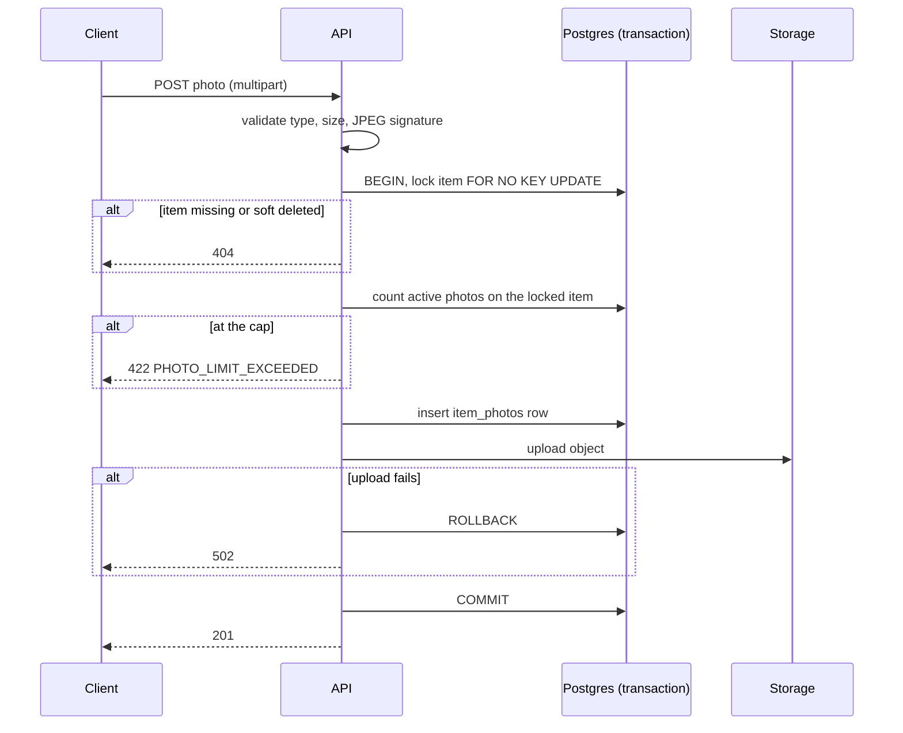

# Attach user-taken photos to items (#213)

Status: proposal. Names of tables, columns, routes, request keys, buckets and error codes below are proposals; each is listed under "Open decisions" and none is final.

## To-Be

- A user can take a photo, or pick one from the library, and attach it to a product (item). Manually created products, which have no image today, get one
- Today the only product image is `product_masters.image_url`, returned by the JAN API lookup. An item without a product master has none
- Operations the user performs:
  1. Open a stock detail
  2. Tap "add photo" on the product section, choose camera or library, and (for the camera) take the shot
  3. The app shrinks the photo, uploads it and shows the thumbnail on the stock detail
  4. Tap a photo to see it larger and to delete it
- What the user sees:
  - Own photos first on the stock detail (thumbnail strip), and the first own photo as the thumbnail on stock list rows
  - If the item has no own photo, the `image_url` from the product master as today; if neither exists, no image
  - On a failed upload, an error message with the reason (too large, not an image, limit reached, no network) and the photo is not shown as attached
- Not in scope: photos on individual stocks (see decision), photo reordering, editing or cropping beyond resize, offline queueing of uploads, sharing photos outside the group

## Storage choice

Options evaluated against what the repo already uses:

- What exists: Supabase (Postgres and Auth) on the Free plan in Tokyo (decision D-02 in `project_v1_1_0_decisions`), the API on oi1 Coolify, `docs/flow/v1.0.0/tech-stack.md` lists "Postgres + Auth + Storage + Realtime" under Supabase, and `supabase/config.toml` has `[storage] enabled = true` with commented example buckets. Mobile already holds a Supabase session (`src/supabase.ts`)
- Option 1: Supabase Storage (the issue's candidate). Already part of the project, no new vendor, no new secret class beyond the secret key that already exists in Infisical
- Option 2: S3 compatible storage outside Supabase (for example an object store on the existing hosting). New vendor, new credentials, new egress path, no gain at this size
- Option 3: Google Drive (the title of the old issue #115 mentions it). Wrong tool: per-user OAuth scopes, quota tied to a personal account, group sharing does not map to Drive sharing
- Option 4: bytea in Postgres. Rejected: row size and backup size grow with every photo, and the database size allowance of the Free plan is shared with all other data (its value was not checked for this doc)

Verified Supabase limits (quotes from the official pages, fetched 2026-11-22):

- Pricing page, Free plan Storage: "1 GB included" file storage, "50 MB" max upload size, "5 GB egress", "5 GB included" cached egress, image transformations "Not included"
- Pricing page, Pro plan: "100 GB included, then $0.0213 per GB" storage, "500 GB" max upload size, "250 GB egress (then $0.09 per GB)", image transformations "100 origin images included, then $5 per 1000 origin images"
- File limits page: "For Free projects, the limit can't exceed 50 MB." and per-bucket limits "can't be higher than this global limit"
- Access control page: "By default Storage does not allow any uploads to buckets without RLS policies." and policies are created "on the `storage.objects` table"

Sizing (an estimate from typical sizes, not measured in this project): a phone photo is a few MB; resized on the device to a long edge of 1280 px as JPEG, a photo is roughly 200 to 400 KB. At those sizes the 1 GB Free allowance holds roughly 2,500 to 5,000 photos. A family group with a handful of photos per item stays far below it; the 5 GB egress allowance is the one to watch if lists load full-size images (the proposal loads small thumbnails client-side from the resized original; Free has no image transformation, so there are no server-made thumbnails)

Free tier consequence: no server-side thumbnails. The upload therefore sends two files or the list screen downloads the resized original. Decision below.

## Data model changes

Proposed table (names pending), `item_photos`:

| Column | Type | Notes |
| --- | --- | --- |
| id | uuid pk | generated by the API (or client, see idempotency in concurrency) |
| group_id | uuid fk groups | for access checks without joining items |
| item_id | uuid fk items | the product the photo belongs to |
| storage_path | text not null | bucket-relative path, `<group_id>/<photo_id>.jpg` |
| content_type | text not null | image/jpeg after resize |
| byte_size | integer not null | checked against the cap |
| width, height | integer | for layout without downloading |
| created_by | uuid fk users | who took it |
| created_at, updated_at, deleted_at | timestamps | the common helper |

- The path contains the group id and the photo id, not the item id, so merging items (#212) repoints `item_photos.item_id` without moving objects
- Cover photo: the first photo by `created_at` (decision below); no `sort_order` column in the first version
- `product_masters.image_url` is untouched; the client prefers own photos, and the DTO exposes both
- Drizzle: new table, relations on `items` and `groups`, zod schemas following the existing pattern

## API changes

Proposed routes (names pending), under `/v1`, group access via `checkGroupAccess` (VIEWER reads, EDITOR writes):

| Method and path | Purpose | Success |
| --- | --- | --- |
| POST `/items/{id}/photos` | upload one photo (multipart, field `file`) | 201 `{ photo }` |
| GET `/items/{id}/photos` | list photos with short-lived signed read URLs | 200 `{ photos: [...] }` |
| DELETE `/items/{id}/photos/{photoId}` | delete a photo | 204 |

- Access model (proposal): the bucket is private and holds no policies for `anon` or `authenticated`, so those roles can neither read nor write objects (default deny from the access control page quote). All access goes through the API, which authorizes by group membership exactly as for every other resource and talks to Storage with the Supabase secret key (`PREP_HAMSTER_SUPABASE_SECRET_KEY`, already in Infisical; the API would need it as a new runtime env on Coolify)
- Why not direct upload from the app with the user's JWT: every policy would have to answer "is this user a member of the group in the path" inside `storage.objects` RLS. `anon` and `authenticated` have all privileges on public tables revoked (migration 0003), so the policy needs a SECURITY DEFINER function that `authenticated` may execute, which is a second authorization implementation next to `checkGroupAccess`, tested separately, and the pitfall memory (`reference_supabase_expo_pitfalls`) says a new function needs its EXECUTE revoked from anon and authenticated, which is the opposite of what such a policy function needs
- Upload through the API: the global body limit is 1 MiB (`MAX_BODY_BYTES` in `middleware/body-limit.ts`). The photo route needs its own higher limit (proposal: 2 MiB, matching the server-side cap) while every other route keeps 1 MiB. The pitfall memory notes that `@hono/zod-openapi` skips validation for non-JSON bodies on routes whose body is not `required: true`; the upload route must validate content type, size and image signature (magic bytes) by hand and declare the body required
- The client resizes before upload (long edge 1280 px, JPEG), so the server accepts only `image/jpeg` up to the cap and rejects anything else. The server does not re-encode (no image library on the API)
- Signed read URLs: `GET` returns URLs valid for a short time (proposal: 1 hour). The client does not store them
- Errors, following the 422 convention for business rules, 413 for oversize:

| Status | Code (proposed) | When |
| --- | --- | --- |
| 404 | NOT_FOUND | item or photo missing, soft deleted, or deleted during the request |
| 403 | existing group-access codes | not a member or VIEWER (writes) |
| 413 | PAYLOAD_TOO_LARGE (existing) | file over the route limit |
| 422 | VALIDATION_ERROR | missing file field |
| 422 | PHOTO_TYPE_UNSUPPORTED | not image/jpeg, or the bytes are not a JPEG |
| 422 | PHOTO_LIMIT_EXCEEDED | the item already has the maximum number of photos |
| 502 | STORAGE_UNAVAILABLE | Storage rejected or failed; nothing is attached |

## Mobile screens touched

- `app/stocks/[id].tsx`: photo strip, "add photo" action sheet (camera or library), full-screen viewer with delete
- Stock list rows: thumbnail from the first own photo, else the product master image
- Pure module `src/photo-upload.ts`: validation, resize plan, multipart building, error-message mapping; tested without rendering like `location-manage.ts`
- New dependencies for capture and resize (to be installed with `expo install` so SDK 58 compatible versions are chosen; versions not verified here): `expo-image-picker` and `expo-image-manipulator`. `expo-camera` is already installed but is a live-preview component for barcode scanning; `expo-image-picker` gives camera and library in one call
- `app.json` plugin entries for the new permission strings (camera and photo library), written in Japanese like the existing `cameraPermission`
- Expo Go: whether both libraries and the camera permission prompts work in Expo Go on Android SDK 58 is not verified; verify in the implementation before relying on it (the pitfall memory shows Expo Go differing from a dev build for URL schemes)

## Migration and RLS

- One drizzle migration creates `item_photos` and runs `ALTER TABLE ... ENABLE ROW LEVEL SECURITY` for it in the same migration (0003 only covered tables that existed then; the every-table-has-RLS e2e check fails otherwise)
- The bucket itself is not a public-schema table. It must be created private with a size cap and the `image/jpeg` content type restriction. Local development: `[storage.buckets.<name>]` in `supabase/config.toml` (the file's own commented example shows `public`, `file_size_limit` and `allowed_mime_types`). Hosted project: creating it through the Storage API or an SQL insert into the storage schema; the plain Postgres used by the API e2e has no storage schema, so any SQL for it must be guarded (the way 0003 guards `anon` and `authenticated`). The way to provision it is a decision below
- `storage.objects` already has RLS enabled by Supabase; this design adds no policy for `anon` or `authenticated`, and an e2e test uploads with the publishable key and expects rejection
- Existing rows: none

## Concurrency

Pattern from #192 and PR #219: decisions on locked rows inside the transaction, fixed lock order.

- The count and the insert run under the item row lock, so two concurrent uploads at one below the cap cannot both pass. The upload to Storage happens inside the open transaction (a few hundred KB, bounded by a timeout); a failed upload rolls the row back. The reverse failure (object stored, commit fails) leaves an orphan object, which a cleanup job can find by listing objects without a row; the first version accepts that as a known gap and logs it
- Delete: lock the photo row, set `deleted_at`, then remove the object. If removing the object fails, the row is already soft-deleted and the object is an orphan, handled the same way
- Merge (#212) and photo upload both lock the item row first, so they serialize; an upload against a merged-away item gets 404
- Item delete currently checks stock references outside a transaction (same shape as #220). Item delete should also refuse or cascade for photos; proposal is to soft-delete the photos together with the item in the same transaction, then remove the objects

## Tests

- API e2e (`item-photos.test.ts`, concurrency in a separate file using `lock-helper.ts`; the Storage call goes to a fake that records requests, because the e2e stack starts only Postgres, per `reference_stock_quantity_and_local_e2e`):
  1. upload then list returns the photo with a signed URL; delete removes it
  2. non-JPEG bytes with an image content type 422; over-cap body 413 without touching the item; VIEWER 403; cross-group item 404
  3. the cap: the Nth photo succeeds, the next 422
  4. races: two uploads at the cap minus one (exactly one succeeds); upload against item delete; upload against merge
  5. Storage failure leaves no `item_photos` row
- A test against a real local Supabase Storage (started with the storage service, not part of the DB-only e2e) uploads with the publishable key and expects rejection; this one needs the storage-api container and is run on demand
- Unit: `photo-upload.ts` validation and error mapping; the fallback order (own photo, then product master image, then none)
- Maestro: the camera and the system photo picker cannot be driven reliably in the emulator flow. The flow asserts only that the "add photo" entry and the picker open; the capture itself is verified by hand on a device and recorded as such, not claimed as automated
- Negative control per branch (type check, cap, lock, rollback on failure, preference order)

## Dependencies

- #212 (merge): photo rows repoint, objects stay (path has no item id)
- #186 (quantities): none
- Supabase plan limits above: the Free allowance is enough for the estimated volume; moving to Pro changes nothing in the design

## Open decisions

### D-photo-target. What a photo attaches to

- Question: does a photo attach to the item or to the individual stock?
- Options:
  1. Item. Identifies the product; manual products get an image; survives buying the same product again
  2. Stock. Records the condition of a specific lot (the old preppin requirement mentions recording the state)
  3. Item, with an optional stock reference
- Recommendation: item only
- Reason: the issue's first goal is that manual products have no image; lot-condition photos can be added later through an optional column without changing the item flow. The issue text says "item (or stock)", so this needs confirmation

### D-photo-storage. Storage backend

- Question: which storage holds the photos?
- Options: Supabase Storage; an S3-compatible store outside Supabase; Google Drive
- Recommendation: Supabase Storage
- Reason: already in the stack and the Free allowance (1 GB, 50 MB upload cap, 5 GB egress, quoted above) covers the estimated volume; the others add a vendor or a mismatch with group sharing

### D-photo-access. How the app reaches Storage

- Question: does the app upload directly with the user's JWT under `storage.objects` policies, or through the API?
- Options: through the API (private bucket, no policies for anon or authenticated, secret key in the API); direct upload with membership policies using a SECURITY DEFINER function; public bucket with unguessable paths
- Recommendation: through the API
- Reason: one authorization implementation (`checkGroupAccess`), consistent with the rest of the API and with the revoked table privileges; a public bucket makes every photo of every household readable by anyone with a link

### D-photo-upload-path. One-step proxy or signed upload URL

- Question: does the file go through the API in one request, or does the API hand out a signed upload URL and the client uploads directly?
- Options: proxy through the API (multipart, 2 MiB route limit); signed upload URL plus a second "complete" call
- Recommendation: proxy through the API
- Reason: one request, the row and the object succeed or fail together, no pending rows to clean up; the cost is API bandwidth for files of a few hundred KB

### D-photo-thumbnails. Thumbnails on the Free plan

- Question: how are list thumbnails produced, given Free has no image transformation?
- Options: the client uploads a second small file (for example 320 px) next to the original; the list downloads the resized original; upgrade to Pro for transformations
- Recommendation: the list downloads the resized original, revisit if egress approaches the allowance
- Reason: no second object to keep in sync, and the estimated volume is small; Pro is a paid plan for a feature this app does not yet need (the Pro monthly price was not collected for this doc; check it before deciding)

### D-photo-limits. Size and count limits

- Question: what are the per-photo size cap and the per-item photo cap?
- Options: 2 MiB and 5 photos; 5 MiB and 10 photos; 1 MiB (the existing global body limit) and 3 photos
- Recommendation: 2 MiB and 5 photos
- Reason: the client resizes to a few hundred KB, so 2 MiB leaves a wide margin while staying far below the 50 MB Free cap; 5 photos covers front, back, label, condition

### D-photo-names. Table, bucket, route and field names

- Question: what are the table name, bucket name, route paths and request keys?
- Options: table `item_photos`, bucket `item-photos`, routes `/items/{id}/photos`, field `file`; table `item_images` with `/items/{id}/images`; photos as a column array on `items`
- Recommendation: `item_photos`, `item-photos`, `/items/{id}/photos`, `file`
- Reason: the issue says photos; a separate table keeps per-photo metadata and soft delete; an array column cannot hold them

### D-photo-delete. What deleting a photo does to the object

- Question: is the stored object removed immediately when the user deletes a photo?
- Options: remove the object at once and soft-delete the row; keep both for 90 days like other entities
- Recommendation: remove the object at once and soft-delete the row
- Reason: a user who deletes a photo of their home expects it gone; the 90 day retention in `docs/stock/operational-policy.md` section 1.1 is for restorable records, and there is no restore UI for photos

### D-photo-bucket-provisioning. How the bucket is created

- Question: how is the private bucket created on the hosted project and locally?
- Options: `[storage.buckets.*]` in `supabase/config.toml` for local and a one-time Storage API call for hosted; a guarded SQL insert in a drizzle migration (skipped where no storage schema exists); the API creates it at boot if missing
- Recommendation: `config.toml` for local plus a guarded SQL insert in the migration for hosted
- Reason: keeps the bucket definition in git next to the table; the guard keeps the DB-only e2e working; boot-time creation in the API gives the API a permission it should not need at runtime

### D-photo-capture-libs. Capture and resize libraries

- Question: are `expo-image-picker` and `expo-image-manipulator` the libraries for capture and resize?
- Options: those two; `expo-camera` only (already installed) with its own capture and no library picker; no client-side resize (upload the original)
- Recommendation: `expo-image-picker` and `expo-image-manipulator`
- Reason: one call covers camera and library with the OS permission flow; without resize a 4 MB original per photo cuts the Free allowance to a few hundred photos
