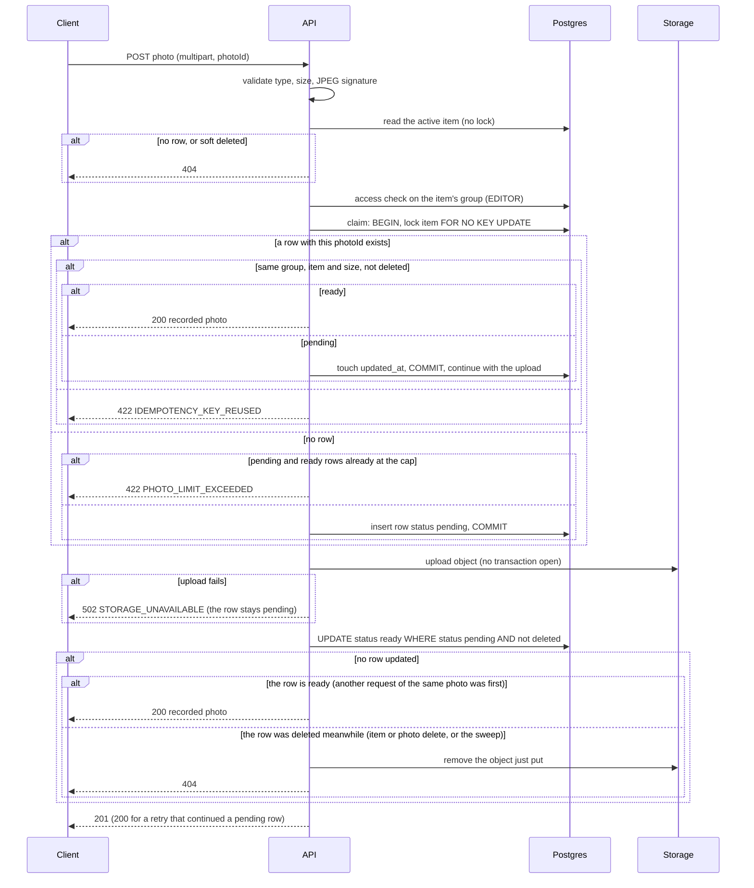

# Attach user-taken photos to items (#213)

Status: decided (2026-11-22) and implemented. Every item under "Open decisions" was decided as recommended (each carries its `Decided:` line). Where the implementation settled a point the first revisions left open (issue #238), the Concurrency section says so.

## To-Be

- A user can take a photo, or pick one from the library, and attach it to a product (item). Manually created products, which have no image today, get one
- Today the only product image is `product_masters.image_url`, returned by the JAN API lookup. An item without a product master has none
- Operations the user performs:
  1. Open a stock detail
  2. Tap "add photo" on the product section, choose camera or library, and (for the camera) take the shot
  3. The app shrinks the photo, uploads it and shows the thumbnail on the stock detail
  4. Tap a photo to see it larger and to delete it
- What the user sees:
  - Own photos first on the stock detail (thumbnail strip), and the first own photo as the thumbnail on stock list rows
  - If the item has no own photo, the `image_url` from the product master as today; if neither exists, no image
  - On a failed upload, an error message with the reason (too large, not an image, limit reached, no network) and the photo is not shown as attached
- Not in scope: photos on individual stocks (see decision), photo reordering, editing or cropping beyond resize, offline queueing of uploads, sharing photos outside the group

## Storage choice

Options evaluated against what the repo already uses:

- What exists: Supabase (Postgres and Auth) on the Free plan in Tokyo (decision D-02 in `project_v1_1_0_decisions`), the API on oi1 Coolify, `docs/flow/v1.0.0/tech-stack.md` lists "Postgres + Auth + Storage + Realtime" under Supabase, and `supabase/config.toml` has `[storage] enabled = true` with commented example buckets. Mobile already holds a Supabase session (`src/supabase.ts`)
- Option 1: Supabase Storage (the issue's candidate). Already part of the project, no new vendor, no new secret class beyond the secret key that already exists in Infisical
- Option 2: S3 compatible storage outside Supabase (for example an object store on the existing hosting). New vendor, new credentials, new egress path, no gain at this size
- Option 3: Google Drive (the title of the old issue #115 mentions it). Wrong tool: per-user OAuth scopes, quota tied to a personal account, group sharing does not map to Drive sharing
- Option 4: bytea in Postgres. Rejected: row size and backup size grow with every photo, and the database size allowance of the Free plan is shared with all other data (its value was not checked for this doc)

Verified Supabase limits (quotes from the official pages, fetched 2026-11-22):

- Pricing page, Free plan Storage: "1 GB included" file storage, "50 MB" max upload size, "5 GB egress", "5 GB included" cached egress, image transformations "Not included"
- Pricing page, Pro plan: "100 GB included, then $0.0213 per GB" storage, "500 GB" max upload size, "250 GB egress (then $0.09 per GB)", image transformations "100 origin images included, then $5 per 1000 origin images"
- File limits page: "For Free projects, the limit can't exceed 50 MB." and per-bucket limits "can't be higher than this global limit"
- Access control page: "By default Storage does not allow any uploads to buckets without RLS policies." and policies are created "on the `storage.objects` table"

Sizing (an estimate from typical sizes, not measured in this project): a phone photo is a few MB; resized on the device to a long edge of 1280 px as JPEG, a photo is roughly 200 to 400 KB. At those sizes the 1 GB Free allowance holds roughly 2,500 to 5,000 photos. A family group with a handful of photos per item stays far below it; the 5 GB egress allowance is the one to watch if lists load full-size images (the proposal loads small thumbnails client-side from the resized original; Free has no image transformation, so there are no server-made thumbnails)

Free tier consequence: no server-side thumbnails. The upload therefore sends two files or the list screen downloads the resized original. Decision below.

## Data model changes

Proposed table (names pending), `item_photos`:

| Column                             | Type             | Notes                                                                                                                                                                                                                                                                                                                                                                   |
| ---------------------------------- | ---------------- | ----------------------------------------------------------------------------------------------------------------------------------------------------------------------------------------------------------------------------------------------------------------------------------------------------------------------------------------------------------------------- |
| id                                 | uuid pk          | generated by the client and sent with the upload, so a retry is recognized (see Concurrency)                                                                                                                                                                                                                                                                            |
| group_id                           | uuid fk groups   | for access checks without joining items                                                                                                                                                                                                                                                                                                                                 |
| item_id                            | uuid fk items    | the product the photo belongs to                                                                                                                                                                                                                                                                                                                                        |
| storage_path                       | text not null    | bucket-relative path, `<group_id>/<photo_id>.jpg`                                                                                                                                                                                                                                                                                                                       |
| content_type                       | text not null    | image/jpeg after resize                                                                                                                                                                                                                                                                                                                                                 |
| byte_size                          | integer not null | checked against the cap                                                                                                                                                                                                                                                                                                                                                 |
| width, height                      | integer null     | sent by the client as form fields (the resize step knows them) so layout does not need a download; bounded positive integers, never trusted for anything but layout                                                                                                                                                                                                     |
| created_by                         | uuid fk users    | who took it                                                                                                                                                                                                                                                                                                                                                             |
| created_at, updated_at, deleted_at | timestamps       | the common helper                                                                                                                                                                                                                                                                                                                                                       |
| status                             | text not null    | `pending` (the row exists, the object is not placed yet or not confirmed) or `ready` (the object is placed; the only state readers see). A check constraint allows only these two. The name `status` and the two values were decided on 2026-11-22 (D-photo-status); a rename touches the column, one check constraint and the `status` literals in `photos/service.ts` |
| storage_deleted_at                 | timestamptz null | set when the object of a soft-deleted photo has been removed from Storage (or was not found); a soft-deleted row with this column null is a removal still pending                                                                                                                                                                                                       |

- The path contains the group id and the photo id, not the item id, so merging items (#212) repoints `item_photos.item_id` without moving objects
- Cover photo: the first photo by `created_at`, ties broken by `id` (decision below); no `sort_order` column in the first version
- `product_masters.image_url` is untouched; the client prefers own photos. The item DTO is not changed; the thumbnail data for list rows comes from the batch route below
- Drizzle: new table, relations on `items` and `groups`, zod schemas following the existing pattern

## API changes

Proposed routes (names pending), under `/v1`, group access via `checkGroupAccess` (VIEWER reads, EDITOR writes):

| Method and path                       | Purpose                                                                   | Success                                                                                                                                                                                                           |
| ------------------------------------- | ------------------------------------------------------------------------- | ----------------------------------------------------------------------------------------------------------------------------------------------------------------------------------------------------------------- |
| POST `/items/{id}/photos`             | upload one photo (multipart, fields `file`, `photoId`, `width`, `height`) | 201 `{ photo }` where `photo` includes a signed read URL, so the client can show the new thumbnail without a second call; 200 with the same body on replay (a ready row), or when a retry continued a pending row |
| GET `/items/{id}/photos`              | list the item's photos with short-lived signed read URLs                  | 200 `{ photos: [...] }`                                                                                                                                                                                           |
| GET `/items/photos?groupId=`          | one cover photo per item of the group, for list rows                      | 200 `{ covers: [{ itemId, photoId, url }] }` (`photoId` is the image cache key)                                                                                                                                   |
| DELETE `/items/{id}/photos/{photoId}` | delete a photo; the photo must belong to item `{id}` (otherwise 404)      | 204                                                                                                                                                                                                               |

- List rows would otherwise need one request per item. The batch route returns the cover (first by `created_at`, then `id`) of every active item that has an active photo, in one query, and signs all paths in one call: `createSignedUrls(paths, expiresIn)` ("Creates multiple signed URLs", Supabase JS reference; the page documents no limit on the number of paths, so the number per call is to be checked at implementation, with chunking if there is a limit). Soft-deleted items and soft-deleted photos are never signed. Signing cost is paid per list refresh, once per group, not per row. Whether it is a separate route or part of `GET /items` is a decision below
- Routing: `GET /items/photos` and `GET /items/{id}` share a path shape, and `photos` is not a UUID, so the static route must be registered before the parameter route or the batch route answers 422 for the id. A test calls the batch route and expects covers, not a validation error
- Signed URLs carry a per-signature token, so a client that caches by URL downloads every photo again after each refresh. The mobile list therefore caches images under a key made from the photo id, not the URL (expo-image's `cacheKey`: "The cache key used to query and store this specific image. If not provided, the `uri` is used also as the cache key", Expo SDK reference), and `cachePolicy` `'disk'`. Without it, 20 rows of 300 KB are 6 MB per refresh, which is the egress risk; with it, each photo is fetched once per device. `expo-image` is not a dependency of the app today and is added with the capture libraries

- Access model (proposal): the bucket is private and holds no policies for `anon` or `authenticated`, so those roles can neither read nor write objects (default deny from the access control page quote). All access goes through the API, which authorizes by group membership exactly as for every other resource and talks to Storage with the Supabase secret key (the key is `PREP_HAMSTER_SUPABASE_SECRET_KEY` in Infisical; the API reads it as the runtime env `SUPABASE_SECRET_KEY`, a new env on Coolify next to the existing `SUPABASE_URL`; without it every photo route answers 503 and the other routes keep working)
- Why not direct upload from the app with the user's JWT: every policy would have to answer "is this user a member of the group in the path" inside `storage.objects` RLS. `anon` and `authenticated` have all privileges on public tables revoked (migration 0003), so the policy needs a SECURITY DEFINER function that `authenticated` may execute, which is a second authorization implementation next to `checkGroupAccess`, tested separately, and the pitfall memory (`reference_supabase_expo_pitfalls`) says a new function needs its EXECUTE revoked from anon and authenticated, which is the opposite of what such a policy function needs
- Upload through the API: the global body limit is 1 MiB (`MAX_BODY_BYTES` in `middleware/body-limit.ts`). The photo route needs its own higher limit while every other route keeps 1 MiB. The limit counts the whole multipart body, so it is the file cap plus room for the multipart framing and the small text fields (proposal: file cap 2 MiB, route limit 2 MiB + 64 KiB); the file part's own size is then checked against 2 MiB, so a file at exactly the cap is accepted and a body just over the route limit gets 413 before any validation. The pitfall memory notes that `@hono/zod-openapi` skips validation for non-JSON bodies on routes whose body is not `required: true`; the upload route must validate content type, size and image signature (magic bytes) by hand and declare the body required
- The client resizes before upload (long edge 1280 px, JPEG), so the server accepts only `image/jpeg` up to the cap and rejects anything else. The server does not re-encode (no image library on the API). The signature check (first bytes `FF D8 FF`) is spoofable: a client can send those bytes followed by anything. The residual risk is accepted because the objects are private, are served only through short-lived signed URLs, and are stored and returned with a fixed `image/jpeg` content type; the check exists to catch mistakes, not to prove the bytes are a valid image
- Signed read URLs: `GET` returns URLs valid for a short time (proposal: 1 hour). The client does not store them
- Errors, following the 422 convention for business rules, 413 for oversize:

| Status | Code (proposed)                   | When                                                                          |
| ------ | --------------------------------- | ----------------------------------------------------------------------------- |
| 404    | NOT_FOUND                         | item or photo missing, soft deleted, or deleted during the request            |
| 403    | existing group-access codes       | not a member or VIEWER (writes)                                               |
| 413    | PAYLOAD_TOO_LARGE (existing)      | body over the route limit, or the file part over the file cap                 |
| 422    | VALIDATION_ERROR                  | missing file or `photoId` field, non-positive or oversized `width` / `height` |
| 422    | IDEMPOTENCY_KEY_REUSED (existing) | `photoId` exists but for another item, another group or another size          |
| 422    | PHOTO_TYPE_UNSUPPORTED            | not image/jpeg, or the bytes are not a JPEG                                   |
| 422    | PHOTO_LIMIT_EXCEEDED              | the item already has the maximum number of photos                             |

| 503 | PHOTO_STORAGE_NOT_CONFIGURED | the API has no Storage secret key; every photo route answers it |
| 502 | STORAGE_UNAVAILABLE | Storage rejected or failed; the row stays pending and nothing is shown; retry with the same `photoId` |

## Mobile screens touched

- `app/stocks/[id].tsx`: photo strip, "add photo" action sheet (camera or library), full-screen viewer with delete
- Stock list rows: thumbnail from the cover photo (batch route, cached by photo id, see API section), else the product master image. Not part of the first implementation PR: the stock list screen is being rewritten in another open PR, so the batch route exists and the list rows are wired afterwards
- Upload generates `photoId` once per attempt and reuses it on retry, like `newStockId` in the split design
- Pure module `src/photo-upload.ts`: validation, resize plan, multipart building, error-message mapping; tested without rendering like `location-manage.ts`
- New dependencies for capture and resize (to be installed with `expo install` so SDK 58 compatible versions are chosen; versions not verified here): `expo-image-picker` and `expo-image-manipulator`. `expo-camera` is already installed but is a live-preview component for barcode scanning; `expo-image-picker` gives camera and library in one call
- `app.json` plugin entries for the new permission strings (camera and photo library), written in Japanese like the existing `cameraPermission`
- Expo Go: whether both libraries and the camera permission prompts work in Expo Go on Android SDK 58 is not verified; verify in the implementation before relying on it (the pitfall memory shows Expo Go differing from a dev build for URL schemes)

## Migration and RLS

- One drizzle migration creates `item_photos` and runs `ALTER TABLE ... ENABLE ROW LEVEL SECURITY` for it in the same migration (0003 only covered tables that existed then; the every-table-has-RLS e2e check fails otherwise)
- The bucket itself is not a public-schema table. It must be created private with `file_size_limit` equal to the 2 MiB file cap (the global Free limit of 50 MB is never the binding one) and the `image/jpeg` content type restriction. The name, the size limit and the MIME type live in one small shared module of the API package; the deploy script that creates or updates the hosted bucket (idempotent, secret key from Infisical, kept in the repo and written down as a runbook step) and a test that parses `supabase/config.toml` both compare against it, so local and hosted cannot drift apart unnoticed. Local development: `[storage.buckets.<name>]` in `supabase/config.toml` (the file's own commented example shows `public`, `file_size_limit` and `allowed_mime_types`). Hosted project: the Supabase "Creating buckets" page shows an SQL example ("-- Use Postgres to create a bucket." with `insert into storage.buckets`) but says nothing about which role may run it or about policies on `storage.buckets`, so whether the role the drizzle migration connects as may insert there is unverified. If it may not, the migration fails as a whole, and since the guard only checks that the storage schema exists, it would not help. The recommendation therefore provisions the hosted bucket through the Storage API with the secret key as a deploy step, not in a migration. The plain Postgres used by the API e2e has no storage schema either, which is a second reason to keep bucket creation out of the migration. The way to provision it is a decision below
- `storage.objects` already has RLS enabled by Supabase; this design adds no policy for `anon` or `authenticated`. Tests (see Tests) check denial of writes and of reads, and that the bucket is not public
- Existing rows: none

## Concurrency

Pattern from #192 and PR #219: decisions on locked rows inside the transaction.

Lock order shared by the four designs (item, stock, location, photo and tag rows): item rows (ascending id), then stock rows, then location rows, then photo rows, then tag rows (ascending id). A transaction takes only the kinds it needs, in this order, and never returns to an earlier kind. Several rows of one kind are locked with one `SELECT ... FOR ...` statement per row after sorting the ids in application code. The one exception is a single `UPDATE` that touches many rows of one kind (merge's repoint of stocks and of photos). It is safe because no other transaction locks more than one row of that kind at a time (consume, discard, move, split and photo delete each lock one row), and two merges that could touch the same rows are serialized by the item locks. Writing to an item row that the transaction already holds the lock on is not a new lock.

Row first (decided 2026-11-22, replacing the earlier object-first design with adoption, photoId advisory locks and registration deadlines): the row is written before the object, so every object in the bucket has a row that names it, and no decision ever has to be made about an object that has no row. No database transaction, connection or row lock is held across a Storage call anywhere, in the request path or in the sweep.

- The claim is the only place that decides: item active, idempotency of `photoId`, the cap. The cap counts pending and ready rows, so a photo that is still uploading takes its slot, and the item row lock makes two concurrent claims at one below the cap come out as one accepted and one refused, before the loser touches Storage
- Idempotency: `photoId` is the row's primary key. A retry with the same `photoId`, group, item and byte size finds the row: ready is a replay (200, no Storage call), pending continues from the upload step. Any other combination, including a deleted row, is 422 `IDEMPOTENCY_KEY_REUSED`. The object path is derived from the row (`<group_id>/<photo_id>.jpg`), so the upload may find an object left by an earlier attempt of the same photo; that is a success (upsert false, and an "already exists" answer is read as done, never as an error). Identical requests racing each other both upload the same bytes to the same path and the ready update is a single statement, so one of them wins and the other reads the winner's row (200)
- Atomicity is not claimed. A failed upload leaves a pending row, which readers never see and the same `photoId` continues; a pending row nobody continues is taken by the sweep
- The ready update is the only writer of `status = ready`, and it matches only a pending row that is not deleted. Everything that can end a pending photo (an item delete, the sweep) first soft-deletes the row with its own single statement, so an upload that is still running finds its row gone at the ready update, removes the object it put, and answers 404. A row that was marked ready can never be taken by the sweep, and a row the sweep took can never be marked ready. When the removal of that late object fails, the request resets `storage_deleted_at` to null, so the row is a pending removal again and the sweep retries it
- Pending staleness: a pending row whose `updated_at` is more than 20 minutes old (`PENDING_STALE_AFTER_MS`) belongs to a request that died. One request ends within a few Storage timeouts (30 seconds each), so 20 minutes is more than 10 times what a live request needs; it is short enough that an abandoned row frees its slot under the cap soon. A retry touches `updated_at` in the claim, so a row that is being continued is not stale
- Sweep (`jobs/photo-sweep.ts`, `bun run job:photo-sweep`, idempotent, scheduled like `jobs/expiry-notify.ts`; the schedule is a deploy step): (1) one `UPDATE ... WHERE status = 'pending' AND deleted_at IS NULL AND updated_at < now - 20 minutes` soft-deletes the stale pending rows (at most 500 per run). The row is taken before its object is touched, because removing the object first would let a request that is only slow mark the row ready afterwards, with its object gone. (2) Every row that is soft-deleted with `storage_deleted_at` null (the rows of step 1, and the rows of photo and item deletes whose removal failed, once they are older than 5 minutes so the API's own first attempt is not raced) gets its object removed outside any transaction, and then `storage_deleted_at` set. Failed removals are counted and make the job exit non-zero; the next run retries them
- Two claims of one new `photoId` on different items take different item locks, so both can reach the INSERT; the primary key lets one win and the other is answered 422 `IDEMPOTENCY_KEY_REUSED`, the same answer as any other row that belongs to something else
- The sweep's claiming UPDATE repeats the staleness test on `updated_at` (READ COMMITTED re-checks it on the newest row version), so a retry that touched the row after the sweep's snapshot is not swept. A retry's touch matches only a pending row that is not deleted; when the row was deleted in between, the claim answers 422 for that photoId
- Every writer that records a removal as done matches the `updated_at` it read. `discardUploaded`, which hands a row back to the sweep, advances `updated_at`, so a removal that started earlier cannot overwrite it with a done mark while an object is still in Storage
- An upload that ends in an exception (a timeout can come after the object was stored) checks the row afterwards and removes the object only when the row was deleted; a live row is left to the retry with the same photoId
- There is no scan of the bucket for objects without a row, because no code path puts an object before its row. The only object that can outlive its row is the one a late upload puts after the sweep or a delete took the row, and the upload removes it itself (see above)
- What this settles from #238: (1) an object is never deleted on the grounds that a row is absent, because the row exists first and its state (pending, ready, deleted) is what decides; (2) there is no sweep against a registration in flight, because the sweep never looks at objects, and its soft delete of a pending row races the ready update as two single statements; (3) a new `photoId` while an orphan remains cannot occur, since a retry with the old `photoId` always continues the same row, so the client keeps one `photoId` per picked photo and mints a new one only after a 4xx that the server decided; (4) the cap check and the idempotency check are one transaction, so a row that exists but does not match is always `IDEMPOTENCY_KEY_REUSED` and never `PHOTO_LIMIT_EXCEEDED`
- The probe is scoped to the item's group, which is read (active only; a soft-deleted item is 404, like the sibling routes) and access-checked first, so a deleted item cannot be told apart from a missing one by a non-member. A `photoId` that exists in another group looks like any other taken id: 422 IDEMPOTENCY_KEY_REUSED. That answer does tell the caller that the id is in use somewhere; it is accepted, because the caller has to guess a random UUID to learn it, and the answer carries no group, item or content
- Delete: one `UPDATE ... WHERE id, item_id (the item in the path), status = 'ready' and deleted_at IS NULL RETURNING` sets `deleted_at` (the statement locks the row, so two concurrent deletes of one photo give one 204 and one 404; a pending photo, a photo of another item and an already deleted photo are 404 and stay untouched); the API then tries to remove the object and, when that works, sets `storage_deleted_at` on the row. The API answers 204 as soon as the row is soft deleted, also when the removal failed: the photo is gone for every user at that point, and the object is removed later by the sweep. Signed read URLs issued before the delete stay valid until their expiry (one hour) or until the object is removed, whichever comes first, and a client that cached the bytes keeps them
- Merge (#212) and photo upload both lock the item row first (the claim), so they serialize; an upload against a merged-away item gets 404 at the claim
- Item delete: the photos of the item, pending ones included, are soft-deleted in the same transaction as the item (their objects are then removed and `storage_deleted_at` is set after the commit, or by the sweep), so a deleted item does not keep reachable photos. The locking of item delete is specified in `item-merge.md`

## Tests

- API e2e (`item-photos.test.ts` for the routes and `item-photos-flow.test.ts` for the row-first flow and the sweep; the Storage call goes to a fake that records requests and has the real Storage's shapes, because the e2e stack starts only Postgres, per `reference_stock_quantity_and_local_e2e`; the shapes are pinned against the real Storage by the opt-in `photo-storage-real.test.ts`):
  1. upload then list returns the photo with a signed URL; delete removes it
  2. non-JPEG bytes with an image content type 422; over-cap body 413 without touching the item; VIEWER 403; a deleted or missing item 404
  3. the cap: the Nth photo succeeds, the next 422; pending rows count; a full item uploads nothing
  4. the order: while the fake Storage holds the upload, the row exists as pending and the list and covers do not show it; afterwards it is ready
  5. a failed upload answers 502 and leaves a pending row; a retry with the same `photoId` continues it and ends ready with one row and a second upload call; a retry with another size or for another item is 422
  6. no database transaction is open at the moment of any Storage call (upload, remove, signing, sweep): the fake looks at `pg_stat_activity` when it is called
  7. no connection is held across the upload: with a single-connection pool and the fake Storage blocked, a tag PUT on the same item still finishes
  8. races: two uploads at the cap minus one (one accepted, the loser never touches Storage); identical concurrent uploads (one row, one object, 200 and 201, nothing removed); an item deleted during the upload (404, the object just put is removed); a sweep of a stale pending row during a slow upload (404, object removed, the row cannot be marked ready afterwards); a removal failure in that late path puts the row back to pending removal
  9. the batch route returns the cover of each item and nothing for items without ready photos; two photos of one item share the same `created_at` in the fixture so the tie goes to the smaller id; soft-deleted photos and items and pending rows are not returned; DELETE with a photo id that belongs to another item or another group returns 404 with the same body as an unknown id, and a pending photo cannot be deleted
  10. a `photoId` from another group returns the same 422 body as an unrelated taken id
  11. what the fake records is asserted, not only the response: bucket name, object path (`<group_id>/<photo_id>.jpg`), content type, and that read URLs come from a signing call with an expiry
  12. delete: with the fake Storage failing the removal, the API still answers 204 and the row has `storage_deleted_at` null
  13. sweep: a pending row quiet for 20 minutes is taken and its object removed; younger pending rows and ready rows of any age are not touched; a failed removal is counted, makes the job exit non-zero and is retried by the next run; a deleted row younger than 5 minutes is left to the API's own attempt
- Denial tests: every new table is checked for denial as the `anon` and `authenticated` roles (explicit skip when those roles are missing, never a silent pass). Against a real local Supabase Storage (opt-in, `PHOTO_STORAGE_TEST_*` env, on demand, not part of the DB-only e2e): an upload with the publishable key is rejected, an anonymous GET of an existing object path is rejected, and the bucket's `public` flag is false (a write rejection alone would pass even if the bucket had been created public)
- Provisioning check: a unit test parses `supabase/config.toml` and asserts the bucket is non-public with the 2 MiB `file_size_limit` and the `image/jpeg` restriction, comparing with the shared module; the same opt-in real-Storage test runs the deploy script against the local Supabase Storage and reads the bucket back, so the hosted path is exercised by the same code and not only the local file
- Unit: `photo-upload.ts` validation and error mapping; the fallback order (own photo, then product master image, then none)
- Maestro: the camera and the system photo picker cannot be driven reliably in the emulator flow. The flow asserts only that the "add photo" entry and the picker open; the capture itself is verified by hand on a device and recorded as such, not claimed as automated
- Negative control per branch (type check, cap, claim, ready update, sweep, preference order)

## Dependencies

- #212 (merge): photo rows repoint, objects stay (path has no item id); a merge whose summed photos would exceed the per-item limit is blocked (D-merge-caps in `item-merge.md`)
- #186 (quantities): none
- Supabase plan limits above: the Free allowance is enough for the estimated volume; moving to Pro changes nothing in the design

## Operations

- Required environment on the API host: `SUPABASE_URL` and `SUPABASE_SECRET_KEY` (the secret key, never the publishable key). Without them the API still starts and only the photo routes answer 503
- Migration: apply `0006_item_photos.sql` with `DATABASE_URL=<url> bun run --filter @prep-hamster/db db:migrate` before the API version that serves photos is deployed
- Bucket: create or align the private bucket once per Supabase project with `bun run --filter @prep-hamster/api provision:photo-bucket` (run with `SUPABASE_URL` and `SUPABASE_SECRET_KEY` set). It is idempotent; run it again after the bucket definition in `photos/config.ts` changes
- Sweep: schedule `bun run --filter @prep-hamster/api job:photo-sweep` once a day with `DATABASE_URL`, `SUPABASE_URL` and `SUPABASE_SECRET_KEY`. It exits non-zero when any removal failed, and the next run retries
- Order for a first deploy: migration, bucket, API, then the sweep schedule

## Open decisions

### D-photo-target. What a photo attaches to

- Decided: item only (2026-11-22)

- Question: does a photo attach to the item or to the individual stock?
- Options:
  1. Item. Identifies the product; manual products get an image; survives buying the same product again
  2. Stock. Records the condition of a specific lot (the old preppin requirement mentions recording the state)
  3. Item, with an optional stock reference
- Recommendation: item only
- Reason: the issue's first goal is that manual products have no image; lot-condition photos can be added later through an optional column without changing the item flow. The issue text says "item (or stock)", so this needs confirmation

### D-photo-storage. Storage backend

- Decided: Supabase Storage (2026-11-22)

- Question: which storage holds the photos?
- Options: Supabase Storage; an S3-compatible store outside Supabase; Google Drive
- Recommendation: Supabase Storage
- Reason: already in the stack and the Free allowance (1 GB, 50 MB upload cap, 5 GB egress, quoted above) covers the estimated volume; the others add a vendor or a mismatch with group sharing

### D-photo-access. How the app reaches Storage

- Decided: through the API (2026-11-22)

- Question: does the app upload directly with the user's JWT under `storage.objects` policies, or through the API?
- Options: through the API (private bucket, no policies for anon or authenticated, secret key in the API); direct upload with membership policies using a SECURITY DEFINER function; public bucket with unguessable paths
- Recommendation: through the API
- Reason: one authorization implementation (`checkGroupAccess`), consistent with the rest of the API and with the revoked table privileges; a public bucket makes every photo of every household readable by anyone with a link. Accepted cost (changed: recorded after review): the API then holds the Supabase secret key (`PREP_HAMSTER_SUPABASE_SECRET_KEY`), which is a project-level admin credential that bypasses RLS for Storage, Auth and the Data API. The API already connects to the database as the table owner, so the added database exposure is small, but a leak of that key now also exposes Auth administration. The key is a runtime env on Coolify only, never in the app, and is used by the API only for Storage calls

### D-photo-upload-path. One-step proxy or signed upload URL

- Decided: proxy through the API (2026-11-22). Revised 2026-11-22 (judgment queue D-04): the row is written first as `pending`, the object is uploaded outside any transaction, and the row is then marked `ready`; the object-first flow of the earlier revisions is gone

- Question: does the file go through the API in one request, or does the API hand out a signed upload URL and the client uploads directly?
- Options: proxy through the API (multipart, route limit slightly above the 2 MiB file cap, a pending row first, the upload to Storage outside any transaction, then the row marked ready); signed upload URL plus a second "complete" call
- Recommendation: proxy through the API
- Reason (changed): one request from the app. It is not atomic, and the design does not pretend so: the row goes first and is `pending` until the object is placed, so an object never exists without a row that names it, and the states that can be left behind are all rows (a pending row that the same `photoId` continues or the sweep takes). The earlier object-first revisions needed adoption of foreign objects, a per-photo lock and time limits to decide what to do with an object that has no row; the row-first order removes the question. The cost is API bandwidth for files of a few hundred KB and one extra short transaction. The first revision claimed the row and the object succeed or fail together, which was wrong, and held a transaction open across the upload, which the second revision removed

### D-photo-thumbnails. Thumbnails on the Free plan

- Decided: the list downloads the resized original, cached on the device under a key made from the photo id (2026-11-22)

- Question: how are list thumbnails produced, given Free has no image transformation?
- Options: the client uploads a second small file (for example 320 px) next to the original; the list downloads the resized original; upgrade to Pro for transformations
- Recommendation: the list downloads the resized original, cached on the device under a key made from the photo id (`expo-image` `cacheKey`), revisit if egress approaches the allowance (changed: the cache key was added after review)
- Reason: signed URLs change on every refresh, so without a stable cache key each refresh re-downloads every cover (20 rows of 300 KB are 6 MB, and about 1,000 such refreshes a month would reach the 5 GB egress allowance). With the cache key a cover is fetched once per device. There is no second object to keep in sync, and the estimated volume is small; Pro is a paid plan for a feature this app does not yet need (the Pro monthly price was not collected for this doc; check it before deciding)

### D-photo-limits. Size and count limits

- Decided: 2 MiB and 5 photos (2026-11-22)

- Question: what are the per-photo size cap and the per-item photo cap?
- Options: 2 MiB and 5 photos; 5 MiB and 10 photos; 1 MiB (the existing global body limit) and 3 photos
- Recommendation: 2 MiB and 5 photos
- Reason: the client resizes to a few hundred KB, so 2 MiB leaves a wide margin while staying far below the 50 MB Free cap; 5 photos covers front, back, label, condition

### D-photo-names. Table, bucket, route and field names

- Decided: `item_photos`, `item-photos`, `/items/{id}/photos` and `/items/photos`, fields `file`, `photoId`, `width`, `height`, and `storage_deleted_at` (2026-11-22)

- Question: what are the table name, bucket name, route paths and request keys?
- Options: table `item_photos`, bucket `item-photos`, routes `/items/{id}/photos` and `/items/photos`, fields `file`, `photoId`, `width`, `height`; table `item_images` with `/items/{id}/images`; photos as a column array on `items`
- Recommendation: `item_photos`, `item-photos`, `/items/{id}/photos` and `/items/photos` (response `covers` with `itemId`, `photoId`, `url`), `file`, `photoId`, `width`, `height`, and `storage_deleted_at` (changed: `photoId`, `width`, `height` and the batch route were added in the second revision; `photoId` in the covers and `storage_deleted_at` in the third)
- Reason: the issue says photos; a separate table keeps per-photo metadata and soft delete; an array column cannot hold them

### D-photo-delete. What deleting a photo does to the object

- Decided: option 1 (remove the object at once and soft-delete the row) (2026-11-22)

- Question: is the stored object removed immediately when the user deletes a photo?
- Options:
  1. Remove the object at once and soft-delete the row
  2. Remove the object and delete the row physically
  3. Keep both for 90 days like other entities
- Recommendation: option 1 (changed: option 2 was added after review)
- Reason: a user who deletes a photo of their home expects it gone, so option 3 is out. Between 1 and 2: a soft-deleted row can never be restored into a working image, so its only value is an audit record that a photo existed; option 1 follows the written rule that user deletions are logical (`docs/stock/operational-policy.md` section 1.1), option 2 is simpler and drops a row nothing reads. If the audit record is not wanted, option 2 is the better choice

### D-photo-bucket-provisioning. How the bucket is created

- Decided: `config.toml` for local plus a Storage API call as a deploy step for hosted (2026-11-22)

- Question: how is the private bucket created on the hosted project and locally?
- Options: `[storage.buckets.*]` in `supabase/config.toml` for local and a Storage API call (secret key) as a deploy step for hosted; a guarded SQL insert in a drizzle migration (skipped where no storage schema exists); the API creates it at boot if missing
- Recommendation: `config.toml` for local plus a Storage API call as a deploy step for hosted (changed; the first revision recommended the SQL insert in the migration)
- Reason: the Supabase docs show the SQL insert but do not say which role may run it, and a migration role without the privilege would fail the whole migration; the guard only tests that the storage schema exists. The deploy step uses the secret key the API already needs. The bucket definition stays in git: one shared module holds the name, the 2 MiB size limit and the MIME type, a repo script (idempotent) creates or updates the hosted bucket from it, and tests compare `config.toml` and the script's result with it, so hosted and local cannot drift unnoticed (changed: the script and the shared module were added after review). Boot-time creation gives the API a permission it should not need at runtime

### D-photo-list-covers. How list rows get thumbnails (new)

- Decided: a separate batch route (2026-11-22)

- Question: how does the stock list get the cover photo URL of each row?
- Options: a separate batch route returning one cover per item; embed the cover URL in `GET /v1/items`; no batch (list rows call the per-item route)
- Recommendation: a separate batch route
- Reason: signing URLs on every `GET /items` call would cost signing work for callers that do not show photos; per-item calls are one request per row. The batch route signs all covers in one call

### D-photo-idempotency. Upload retry key (new)

- Decided: client-generated `photoId` (2026-11-22)

- Question: how is a retried upload recognized?
- Options: client-generated `photoId` that becomes the row's primary key and the object's name; no key (a retry may create a duplicate)
- Recommendation: client-generated `photoId`
- Reason: upload retries after a timeout are the normal failure on a phone, and a duplicate uses up the per-item cap; the same pattern as `newStockId` in the split design

### D-photo-exif. Location and other metadata in uploaded photos (new)

- Decided: verify on a device that the resize output has no EXIF and add an explicit client-side strip if it does (the implementation also asks the picker for no EXIF; the device check is still to be done by hand) (2026-11-22)

- Question: how is EXIF metadata (GPS position, device) kept out of stored photos?
- Options: verify on a device that the resize output has no EXIF and rely on it; strip metadata explicitly on the client before upload; strip it on the server
- Recommendation: verify on a device with a geotagged test photo that the resize output has no EXIF, and add an explicit client-side strip if it does (the server does not re-encode, so it cannot strip)
- Reason: the Expo image manipulator page does not say whether metadata survives (checked: no mention of EXIF or metadata), and a household photo with a GPS position is personal data that leaves the phone. Group members can view each other's photos, so the home location could be exposed. This is a manual verification step recorded in the implementation, not a CI test

### D-photo-item-delete. What item delete does to its photos (new)

- Decided: soft-delete the photos with the item and remove the objects after the commit (2026-11-22)

- Question: what happens to an item's photos when the item is deleted?
- Options: soft-delete the photos in the same transaction as the item and remove the objects after the commit; refuse the item delete while photos exist (like `ITEM_IN_USE` for stocks); leave the photos
- Recommendation: soft-delete the photos with the item and remove the objects after the commit
- Reason: refusing would force the user to delete photos one by one before deleting a product they already decided to delete; leaving them keeps reachable objects of a deleted item

### D-photo-delete-retry. Retrying the Storage removal of a deleted photo (new)

- Decided: option 1 (`storage_deleted_at` column on `item_photos`) (2026-11-22)

- Question: how is a failed Storage removal after a photo delete retried, and what does the API answer meanwhile?
- Options:
  1. A nullable `storage_deleted_at` column on `item_photos` (proposed name); a soft-deleted row with it null is the pending state, and the sweep retries those rows until the object is gone; the API answers 204 once the row is soft deleted
  2. The sweep treats every soft-deleted row as pending and calls Storage each time (no column)
  3. A separate pending-deletions table
  4. Answer 502 when the removal fails and keep the photo visible
- Recommendation: option 1
- Reason: the pending removal must be persisted on the row, so that the sweep finds the objects it still has to remove without scanning the bucket. A column on the existing row needs no new table (a new table would need its own RLS statement) and gives the sweep a completion condition. The API answers 204 because the photo is already gone for every user. Option 4 would show a photo the user just deleted. With physical row deletion (option 2 of D-photo-delete) a separate table (option 3) would be needed instead

### D-photo-capture-libs. Capture and resize libraries

- Decided: `expo-image-picker` and `expo-image-manipulator` (2026-11-22)

- Question: are `expo-image-picker` and `expo-image-manipulator` the libraries for capture and resize?
- Options: those two; `expo-camera` only (already installed) with its own capture and no library picker; no client-side resize (upload the original)
- Recommendation: `expo-image-picker` and `expo-image-manipulator`
- Reason: one call covers camera and library with the OS permission flow; without resize a 4 MB original per photo cuts the Free allowance to a few hundred photos

### D-photo-status. Name of the upload state column

- Decided: column `status`, values `pending` and `ready` (2026-11-22)

- Question: what is the column called that tells a claimed row from a row whose object is placed?
- Options: `status` with `pending` / `ready`; `state`; a boolean `is_ready`
- Recommendation: `status` with `pending` / `ready`
- Reason: it names what the row is in the upload flow, leaves room for a third value without a new column, and a check constraint pins the two values that exist
