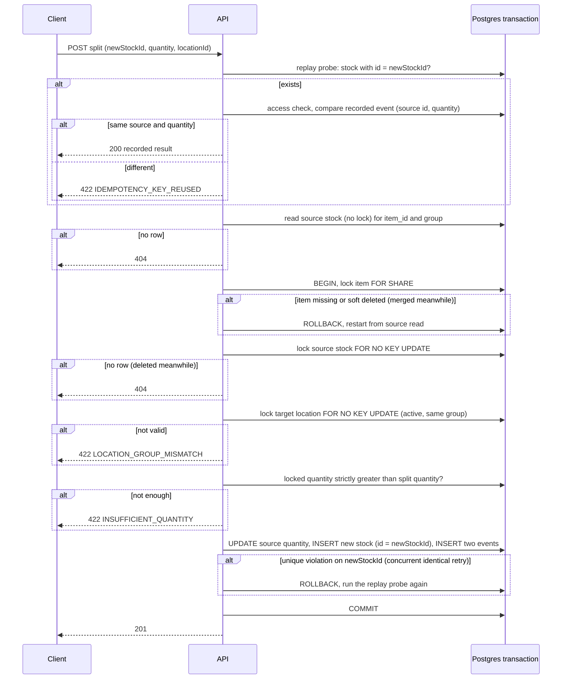

# Split one stock into two (#211)

Status: proposal. Names of routes, request keys, columns, enum values and error codes below are proposals; each is listed under "Open decisions" and none is final.

## To-Be

- A user can take part of one stock and make it a second stock, in one operation, with optional changes on the new part (a different location, different dates)
- Today `POST /v1/stocks/{id}/move` moves a whole stock only, and there is no way to give part of a lot a different expiry
- Operations the user performs (example: 6 bottles, move 3 to the garage):
  1. Open the stock detail of the 6-bottle stock
  2. Tap "split" (new action beside consume, discard and move)
  3. Enter the quantity to split off (3), optionally choose another location, optionally change the use-by or best-before date, optionally add a note
  4. Confirm. The original stock now shows 3 and a second stock of 3 exists in the chosen place, with the chosen dates. Both appear in the stock list
- What the user sees:
  - The screen stays on the original stock with the new quantity, and a line "split off 3 to <location>" with a tap target that opens the new stock
  - In the list, two rows of the same product
- Examples the issue names: partial move to another location; separating the part with a different expiry date
- Not in scope: the touch gesture in the old issue title (#146 of the old repo had no body). The button flow ships first; a gesture can call the same API later
- Not in scope: splitting into more than two in one call (repeat the operation), merging stocks back

## Data model changes

- No new table
- The new stock is an ordinary `stocks` row: same `group_id`, `item_id`, `unit`, `opened_at` as the source; `location_id`, `use_by_date`, `best_before_date` from the request or copied from the source when omitted; `note` from the request only (null when omitted)
- Columns checked against `stocks` in `packages/db/src/schema.ts`: id, group_id, item_id, location_id, quantity, unit, use_by_date, best_before_date, opened_at, note, and the timestamps. No other column needs a copy rule
- Finding: `stock_events` has types ADD, CONSUME, DISCARD, MOVE, EDIT, but the code writes only CONSUME, DISCARD and MOVE. Creating a stock writes no ADD event (verified by searching for the literals). So for an existing stock `SUM(quantity_delta)` is not its quantity; it is the change since creation
- Split must leave an audit trail of both rows and a link between them. Proposal:
  - one event on the source stock with a new type, quantity_delta = minus the split quantity
  - one event on the new stock with the existing ADD type, quantity_delta = plus the split quantity
  - both events carry the other stock's id so the pair can be found
- Asymmetry, stated on purpose: only split-created stocks have an ADD event today, so for them the event sum equals the quantity while for stocks created by POST it does not. Using ADD (not a split-specific type) for the new stock keeps the meaning of ADD ("this stock got this quantity at creation") and means a later change that writes ADD on every creation makes the two kinds of stock consistent. Reports must not assume the event sum equals the quantity for all stocks until that change exists
- Reusing DISCARD for the source side is rejected: DISCARD is waste, and any "discarded quantity" aggregation would count split quantities as waste
- New enum values need `ALTER TYPE ... ADD VALUE`; in the drizzle migration this runs as its own statement before anything uses the value (Postgres does not let a value added in a transaction be used in the same transaction)

## API changes

Proposed route (name pending): `POST /v1/stocks/{id}/split`

Request:

```json
{
  "newStockId": "uuid generated by the client",
  "quantity": 3,
  "locationId": "uuid, optional",
  "useByDate": "YYYY-MM-DD or null, optional",
  "bestBeforeDate": "YYYY-MM-DD or null, optional",
  "note": "string or null, optional"
}
```

Response 201: `{ source: Stock, created: Stock, events: [StockEvent, StockEvent] }`.

Replay: a request whose `newStockId` already exists as a stock created by a split of the same source with the same quantity returns 200 with `{ source, created, events }` read at replay time. `source` and `created` are the current rows (they may have changed since the first call), `events` are the two recorded events. The location, dates and note of the request are not compared on replay, because the stock may have been edited since. The replay check runs before the source lookup and before every quantity and location check (see Concurrency), so it is reachable after the source quantity, the source row or the target location changed.

- `quantity` must be greater than 0 and strictly less than the source's remaining quantity. Splitting off everything is a move, which already exists
- Omitted `locationId`, `useByDate` and `bestBeforeDate` mean "copy from the source". A date sent as null clears the date on the new stock (same meaning as null in `updateStockBodyDtoSchema`). `note` is never copied: omitted or null both give a null note
- Roles: EDITOR or higher, via `checkGroupAccess`, like move and consume

Errors (existing codes are reused wherever the meaning is the same):

| Status | Code | When |
| --- | --- | --- |
| 404 | NOT_FOUND | source missing, soft deleted, or deleted during the request |
| 403 | existing group-access codes | not a member or VIEWER |
| 422 | VALIDATION_ERROR | body fails schema (quantity not positive, bad date) |
| 422 | INSUFFICIENT_QUANTITY | quantity is not strictly less than the remaining quantity (message states both) |
| 422 | LOCATION_GROUP_MISMATCH | `locationId` is not an active location of the same group |
| 422 | IDEMPOTENCY_KEY_REUSED | `newStockId` exists but was not created by a split of this source with this quantity |
| 409 | new code (see decisions) | the source's item was merged away on each of 3 attempts |

Whether a distinct code is wanted for "split off everything" is a decision below; the proposal reuses INSUFFICIENT_QUANTITY.

`quantityStockSplitBodyDtoSchema` follows `stockQuantityDeltaBodyDtoSchema`: positive, finite after `Math.fround` (the column is `real`).

## Mobile screens touched

- `app/stocks/[id].tsx`: a fifth action section "split". Quantity input reuses `parseAmount` with the rule changed to "strictly less than remaining" (a new helper, not a changed `parseAmount`, because consume and discard allow the full amount). Location choice reuses `moveTargets`
- `src/stock-detail.ts` / `use-stock-actions.ts`: `splitStock` call and result handling, with the same pending-operation handling the consume and discard actions use for retries (the client generates `newStockId` once per attempt and reuses it on retry, like `eventId`)
- The post-split state shows both quantities; the new stock is reachable through the response's `created.id`
- List and detail refetch on focus already, so the new row appears without extra code

## Migration and RLS

- One migration: extend `stock_event_type` (if the event decision below adds values) and add the link column on `stock_events` (if chosen)
- No new table, so no new RLS statement. The e2e every-table-has-RLS check is unchanged
- Existing rows: the new column is nullable; no backfill

## Concurrency

Pattern from #192 and PR #219: decisions are made on rows locked inside the transaction. Global lock order for features that touch items, stocks, locations and tags (the same text is in `stock-tags.md` and `item-merge.md`): item rows (ascending id), then stock rows, then location rows, then tag rows (ascending id). Rows of one kind are locked one `SELECT ... FOR ...` statement per row after sorting ids in application code.

- Every transaction that inserts a `stocks` row (stock create and split) holds `FOR SHARE` on the row of the item it attaches the stock to, before inserting. Merge (#212) holds `FOR NO KEY UPDATE` on the source and destination items for its whole transaction. Postgres, Explicit Locking, Table 13.3: FOR SHARE conflicts with FOR NO KEY UPDATE, so an inserter and a merge of that item cannot overlap. The foreign key check on `stocks.item_id` is not enough: it takes the weaker key-share lock, which per the same table does not conflict with FOR NO KEY UPDATE
- Why that closes the race: merge takes its item locks first and runs the repoint `UPDATE stocks` as a later statement, which in READ COMMITTED takes a new snapshot. A split that committed before the merge's lock is visible to that statement and is repointed; a split that starts later waits at the item lock until the merge commits and then sees the item as soft deleted
- Split reads the source stock without a lock to learn its `item_id`, then takes the item lock, then the stock lock. If the item row is missing or soft deleted at that point (a merge moved the stock meanwhile), the transaction is rolled back and the whole operation restarts from the source read. Each restart needs another committed merge in between, so it ends; as a safety bound it stops after 3 attempts with a conflict response (code name in the decisions). After the stock lock, the locked row's `item_id` must equal the locked item's id (checked, expected always true because a merge of that item cannot commit while the split holds the item lock)
- Consume, discard and move take no item lock. A merge's repoint waits for their row locks and rewrites only `item_id`; they do not read the item. This is consistent with the global order (they use a suffix of it)



- The quantity check uses the locked row's value, not the value read before the transaction (consume and discard use a conditional UPDATE for the same effect; split needs the value to build the response and the new row, so it locks first, like move)
- Idempotency: `newStockId` is the new stock's primary key. The replay probe runs first, before any state-dependent check, so a retry of a completed split answers 200 even though the source now holds less than the split quantity, was consumed or deleted, or the target location was deleted. The probe compares the source id and the quantity recorded on the new stock's creation event, in the database (same reason as `findRecordedDeltaEvent`: `real` columns do not round-trip through JS). The access check uses the group of the existing new stock. A `newStockId` that exists but was not created by a split of this source with this quantity returns 422 IDEMPOTENCY_KEY_REUSED. The primary key violation inside the transaction (recognized by the existing `isUniqueViolation`) is only the backstop for two identical requests running at once: it rolls back and runs the probe again. No second `eventId` is needed because the events are created together with the stock
- Concurrent consume or discard on the source: it either commits before the split's lock (the split sees the smaller quantity) or waits for it. The split never reads a stale quantity
- Concurrent location delete: the target lock `FOR NO KEY UPDATE` is the same lock PR #219 takes for move. #220 (location delete checks references outside the transaction) is a related open race on the delete side; split does not make it worse and does not depend on it, but the fix for #220 should cover split as another writer of `stocks.location_id`
- Concurrent delete of the source: the source lock finds the row soft-deleted or gone, and the response is 404

## Tests

- API e2e (`stocks-split.test.ts`, `stocks-concurrency.test.ts` additions with `lock-helper.ts`):
  1. 6 split by 2 to another location (an unequal split, so swapped or overwritten quantities fail): source 4, new 2 at the chosen location, the new stock's ADD event is +2 and the source's event is -2, the two events point at each other
  2. omitted `locationId` and dates copy the source; null date clears the date on the new stock only; `note` is null on the new stock when omitted even if the source has a note
  3. quantity equal to or above remaining: 422, nothing written (no new row, no event); a remainder that rounds to 0 at 6 decimals is rejected the same way
  4. wrong-group location 422; VIEWER 403; deleted source 404
  5. replay: split 3 of 5 (remaining 2, below the split quantity), then the identical request again: 200 with one new stock and no second event. Repeat after the source is consumed to 0, after the source is soft deleted, and after the target location is soft deleted: each answers 200. The same `newStockId` with quantity 1: 422 IDEMPOTENCY_KEY_REUSED. A `newStockId` that belongs to a stock created by POST: 422
  6. races: split against delete of the source (404, no orphan new stock); two splits of 3 against a stock of 5 (exactly one succeeds); split against a consume that leaves too little; two identical requests at once (one 201, one 200, one new stock)
  7. split against merge (with `item-merge.md`): hold the merge's item locks in an open transaction, start the split, release the merge; at the end no active stock references a soft-deleted item, and the split either landed on the destination item or answered 404. Run both orders of arrival
- Unit: `split` input validation (strictly less than remaining), result handling for uncertain outcomes
- Maestro: `stock-detail-split.yaml` modeled on `stock-detail-move.yaml` (split 1 of a unique stock, assert two rows with the product name, assert quantities)
- Negative control per branch: strictly-less check, location check, replay-versus-conflict decision, replay probe moved after the validations (test 5 must fail), removal of the item `FOR SHARE` (test 7 must fail), lock removal on the source stock (the race tests must fail)

## Dependencies

- #186 (quantities stored as `real`, pending decision numeric versus real): the remainder `quantity - q` is computed in the database in float4. Example risk: 0.3 minus 0.1 may leave a value the list treats as empty (list uses `round(quantity::numeric, 6) > 0`) or 0.2000001. This doc does not decide #186. Until #186 is decided, the strictly-less check is applied in the database with the same rounding as the list filter, so a remainder that rounds to 0 is rejected as "split off everything" (a stock whose whole content is invisible to the list, for example 0.0000004, therefore cannot be split, and it is not shown in the list anyway). If #186 moves the column to numeric, the check and the schema refine (`Math.fround`) change with it
- #192 / PR #219: locking pattern (PR #219 is open; the doc assumes its approach for the target location lock)
- #212 (merge): split inserts a stock for an item, so it takes part in the item lock protocol described in Concurrency and in `item-merge.md`. Both docs carry the same lock order and a merge-versus-split race test
- #213: independent of split

## Open decisions

### D-split-events. Event representation of a split

- Question: which event types record a split?
- Options:
  1. Two new enum values (a split-out event on the source, a split-in event on the new stock)
  2. One new enum value used on both rows with the sign of `quantity_delta` telling the side
  3. No new type: DISCARD on the source and ADD (existing, never written) on the new stock
  4. ADD (existing, never written until now) on the new stock and one new enum value on the source
- Recommendation: option 4 (changed in the second revision; the first recommended option 2)
- Reason: option 3 corrupts waste statistics. Option 2 makes the new stock's creation event a non-ADD type, which a report filtering on ADD would miss, and gives split-created stocks event sums that differ in meaning from other stocks without saying so. Option 4 keeps ADD meaning "stock received a quantity" and needs one new value instead of two. The remaining asymmetry (only split-created stocks have an ADD event today) is documented in the data model section

### D-split-link. Linking the two stocks

- Question: how are the source and the new stock linked?
- Options:
  1. New nullable column on `stock_events` pointing at the other stock
  2. New nullable column on `stocks` pointing at the stock it was split from
  3. No link (find pairs by event time)
- Recommendation: option 1
- Reason: the event is the history record and `stocks` stays a pure current-state table; option 3 is ambiguous when two splits happen in the same second

### D-split-idempotency. Idempotency key

- Question: how does a retry of the same split get recognized?
- Options:
  1. Client-generated `newStockId` that becomes the new stock's primary key
  2. Separate `eventId` like consume and discard, stored on one of the two events
  3. No idempotency
- Recommendation: option 1
- Reason: one key covers both rows; mobile already generates ids for retries. The replay is recognized by a probe that runs before the state-dependent checks, with the unique violation only as the backstop for simultaneous retries (the first revision relied on the violation alone, which a retry never reached once the quantity check failed)

### D-split-retry-code. Response when the item lock keeps moving (new)

- Question: which status and code does a split return if it restarted 3 times because the source stock's item was merged away each time?
- Options: 409 with a new code; 503 with a new code; reuse NOT_FOUND
- Recommendation: 409 with a new code (name to be chosen with the other new codes)
- Reason: the request is valid and can be retried by the client; NOT_FOUND would tell the user the stock is gone, which is false

### D-split-route. Route and request key names

- Question: what are the route path and the request keys?
- Options: `POST /v1/stocks/{id}/split` with `quantity`, `locationId`, `newStockId`; `POST /v1/stocks/{id}/divide`; `quantityDelta` instead of `quantity` for symmetry with consume
- Recommendation: `/split`, `quantity`, `locationId`, `newStockId`
- Reason: the issue title says split; `quantityDelta` means a signed change in the existing events and would be confusing for a positive quantity that moves

### D-split-whole. Splitting off the entire quantity

- Question: when `quantity` is not strictly less than the remaining quantity, which error is returned?
- Options: reuse `INSUFFICIENT_QUANTITY`; a new code for "use move instead"
- Recommendation: reuse `INSUFFICIENT_QUANTITY`
- Reason: the message can name the move action; a new code adds client branches for no different handling

### D-split-copy. What the new stock copies

- Question: does the new stock copy `opened_at` and `note` from the source?
- Options: copy `opened_at`, take `note` only from the request; copy both; copy neither
- Recommendation: copy `opened_at`, `note` only from the request
- Reason: an opened lot stays opened when part of it moves; a note about the whole lot is not obviously true of the part

### D-split-gesture. The touch gesture

- Question: is the gesture from the old issue title in the first version?
- Options: button flow only; button plus a swipe action on list rows
- Recommendation: button flow only
- Reason: the old issue had no body, the gesture would call the same API, and a swipe action in the list has no existing pattern in the app to follow
