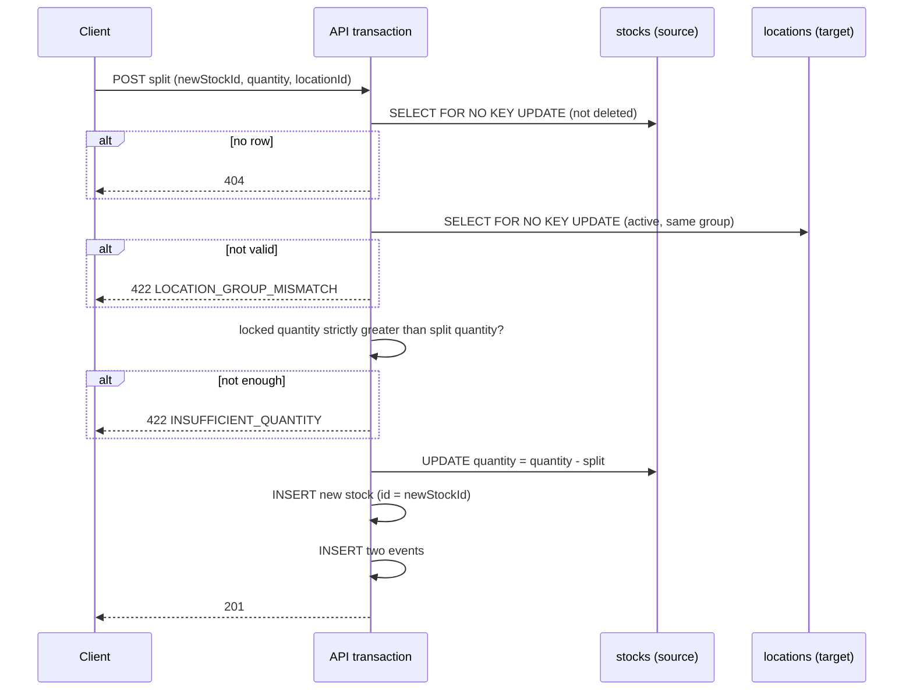

# Split one stock into two (#211)

Status: proposal. Names of routes, request keys, columns, enum values and error codes below are proposals; each is listed under "Open decisions" and none is final.

## To-Be

- A user can take part of one stock and make it a second stock, in one operation, with optional changes on the new part (a different location, different dates)
- Today `POST /v1/stocks/{id}/move` moves a whole stock only, and there is no way to give part of a lot a different expiry
- Operations the user performs (example: 6 bottles, move 3 to the garage):
  1. Open the stock detail of the 6-bottle stock
  2. Tap "split" (new action beside consume, discard and move)
  3. Enter the quantity to split off (3), optionally choose another location, optionally change the use-by or best-before date, optionally add a note
  4. Confirm. The original stock now shows 3 and a second stock of 3 exists in the chosen place, with the chosen dates. Both appear in the stock list
- What the user sees:
  - The screen stays on the original stock with the new quantity, and a line "split off 3 to <location>" with a tap target that opens the new stock
  - In the list, two rows of the same product
- Examples the issue names: partial move to another location; separating the part with a different expiry date
- Not in scope: the touch gesture in the old issue title (#146 of the old repo had no body). The button flow ships first; a gesture can call the same API later
- Not in scope: splitting into more than two in one call (repeat the operation), merging stocks back

## Data model changes

- No new table
- The new stock is an ordinary `stocks` row: same `group_id`, `item_id`, `unit`, `opened_at` as the source; `location_id`, `use_by_date`, `best_before_date`, `note` from the request or copied from the source when omitted
- Finding: `stock_events` has types ADD, CONSUME, DISCARD, MOVE, EDIT, but the code writes only CONSUME, DISCARD and MOVE. Creating a stock writes no ADD event (verified by searching for the literals). So for an existing stock `SUM(quantity_delta)` is not its quantity; it is the change since creation
- Split must leave an audit trail of both rows and a link between them. Proposal:
  - one event on the source stock, quantity_delta = minus the split quantity
  - one event on the new stock, quantity_delta = plus the split quantity, so the new stock's event sum equals its quantity
  - both events carry the other stock's id so the pair can be found
- Reusing DISCARD for the source side is rejected: DISCARD is waste, and any "discarded quantity" aggregation would count split quantities as waste
- New enum values need `ALTER TYPE ... ADD VALUE`; in the drizzle migration this runs as its own statement before anything uses the value (Postgres does not let a value added in a transaction be used in the same transaction)

## API changes

Proposed route (name pending): `POST /v1/stocks/{id}/split`

Request:

```json
{
  "newStockId": "uuid generated by the client",
  "quantity": 3,
  "locationId": "uuid, optional",
  "useByDate": "YYYY-MM-DD or null, optional",
  "bestBeforeDate": "YYYY-MM-DD or null, optional",
  "note": "string or null, optional"
}
```

Response 201: `{ source: Stock, created: Stock, events: [StockEvent, StockEvent] }`. A replay of the same `newStockId` returns 200 with the same body.

- `quantity` must be greater than 0 and strictly less than the source's remaining quantity. Splitting off everything is a move, which already exists
- Omitted optional keys mean "copy from the source". A key sent as null clears the date on the new stock (same meaning as null in `updateStockBodyDtoSchema`)
- Roles: EDITOR or higher, via `checkGroupAccess`, like move and consume

Errors (existing codes are reused wherever the meaning is the same):

| Status | Code | When |
| --- | --- | --- |
| 404 | NOT_FOUND | source missing, soft deleted, or deleted during the request |
| 403 | existing group-access codes | not a member or VIEWER |
| 422 | VALIDATION_ERROR | body fails schema (quantity not positive, bad date) |
| 422 | INSUFFICIENT_QUANTITY | quantity is not strictly less than the remaining quantity (message states both) |
| 422 | LOCATION_GROUP_MISMATCH | `locationId` is not an active location of the same group |
| 422 | IDEMPOTENCY_KEY_REUSED | `newStockId` exists but with different source, quantity or content |

Whether a distinct code is wanted for "split off everything" is a decision below; the proposal reuses INSUFFICIENT_QUANTITY.

`quantityStockSplitBodyDtoSchema` follows `stockQuantityDeltaBodyDtoSchema`: positive, finite after `Math.fround` (the column is `real`).

## Mobile screens touched

- `app/stocks/[id].tsx`: a fifth action section "split". Quantity input reuses `parseAmount` with the rule changed to "strictly less than remaining" (a new helper, not a changed `parseAmount`, because consume and discard allow the full amount). Location choice reuses `moveTargets`
- `src/stock-detail.ts` / `use-stock-actions.ts`: `splitStock` call and result handling, with the same pending-operation handling the consume and discard actions use for retries (the client generates `newStockId` once per attempt and reuses it on retry, like `eventId`)
- The post-split state shows both quantities; the new stock is reachable through the response's `created.id`
- List and detail refetch on focus already, so the new row appears without extra code

## Migration and RLS

- One migration: extend `stock_event_type` (if the event decision below adds values) and add the link column on `stock_events` (if chosen)
- No new table, so no new RLS statement. The e2e every-table-has-RLS check is unchanged
- Existing rows: the new column is nullable; no backfill

## Concurrency

Pattern from #192 and PR #219: decisions are made on rows locked inside the transaction; lock order is stock row, then location row.



- The quantity check uses the locked row's value, not the value read before the transaction (consume and discard use a conditional UPDATE for the same effect; split needs the value to build the response and the new row, so it locks first, like move)
- Idempotency: `newStockId` is the new stock's primary key. A retry hits the primary key (unique violation, recognized by the existing `isUniqueViolation`); the handler then reads the existing row and compares source link, quantity and content in the database (same reason as `findRecordedDeltaEvent`: `real` columns do not round-trip through JS). Same content returns the recorded result (200); different content returns 422 IDEMPOTENCY_KEY_REUSED. No second `eventId` is needed because the events are created together with the stock
- Concurrent consume or discard on the source: it either commits before the split's lock (the split sees the smaller quantity) or waits for it. The split never reads a stale quantity
- Concurrent location delete: the target lock `FOR NO KEY UPDATE` is the same lock PR #219 takes for move. #220 (location delete checks references outside the transaction) is a related open race on the delete side; split does not make it worse and does not depend on it, but the fix for #220 should cover split as another writer of `stocks.location_id`
- Concurrent delete of the source: the source lock finds the row soft-deleted or gone, and the response is 404

## Tests

- API e2e (`stocks-split.test.ts`, `stocks-concurrency.test.ts` additions with `lock-helper.ts`):
  1. 6 split by 3 to another location: source 3, new 3 at the chosen location, event sum matches, two events linked
  2. omitted keys copy the source; null date clears the date on the new stock only
  3. quantity equal to or above remaining: 422, nothing written (no new row, no event)
  4. wrong-group location 422; VIEWER 403; deleted source 404
  5. retry with the same `newStockId` and same body: 200, one new stock; changed quantity with the same id: 422
  6. race: split against delete of the source (404, no orphan new stock); two splits of 3 against a stock of 5 (exactly one succeeds); split against a consume that leaves too little
- Unit: `split` input validation (strictly less than remaining), result handling for uncertain outcomes
- Maestro: `stock-detail-split.yaml` modeled on `stock-detail-move.yaml` (split 1 of a unique stock, assert two rows with the product name, assert quantities)
- Negative control per branch: strictly-less check, location check, replay-versus-conflict decision, lock removal (the race test must fail)

## Dependencies

- #186 (quantities stored as `real`, pending decision numeric versus real): the remainder `quantity - q` is computed in the database in float4. Example risk: 0.3 minus 0.1 may leave a value the list treats as empty (list uses `round(quantity::numeric, 6) > 0`) or 0.2000001. This doc does not decide #186. Until #186 is decided, the strictly-less check is applied in the database with the same rounding as the list filter, so a remainder that rounds to 0 is rejected as "split off everything". If #186 moves the column to numeric, the check and the schema refine (`Math.fround`) change with it
- #192 / PR #219: locking pattern (PR #219 is open; the doc assumes its approach for the target location lock)
- #212 and #213: independent of split (split does not touch items)

## Open decisions

### D-split-events. Event representation of a split

- Question: which event types record a split?
- Options:
  1. Two new enum values (a split-out event on the source, a split-in event on the new stock)
  2. One new enum value used on both rows with the sign of `quantity_delta` telling the side
  3. No new type: DISCARD on the source and ADD (existing, never written) on the new stock
- Recommendation: option 2, one new value, sign tells the side
- Reason: option 3 corrupts waste statistics; option 1 doubles enum values for one operation; one value plus the link keeps the enum small and lets queries find both sides

### D-split-link. Linking the two stocks

- Question: how are the source and the new stock linked?
- Options:
  1. New nullable column on `stock_events` pointing at the other stock
  2. New nullable column on `stocks` pointing at the stock it was split from
  3. No link (find pairs by event time)
- Recommendation: option 1
- Reason: the event is the history record and `stocks` stays a pure current-state table; option 3 is ambiguous when two splits happen in the same second

### D-split-idempotency. Idempotency key

- Question: how does a retry of the same split get recognized?
- Options:
  1. Client-generated `newStockId` that becomes the new stock's primary key
  2. Separate `eventId` like consume and discard, stored on one of the two events
  3. No idempotency
- Recommendation: option 1
- Reason: one key covers both rows and the existing unique-violation handling; mobile already generates ids for retries

### D-split-route. Route and request key names

- Question: what are the route path and the request keys?
- Options: `POST /v1/stocks/{id}/split` with `quantity`, `locationId`, `newStockId`; `POST /v1/stocks/{id}/divide`; `quantityDelta` instead of `quantity` for symmetry with consume
- Recommendation: `/split`, `quantity`, `locationId`, `newStockId`
- Reason: the issue title says split; `quantityDelta` means a signed change in the existing events and would be confusing for a positive quantity that moves

### D-split-whole. Splitting off the entire quantity

- Question: when `quantity` is not strictly less than the remaining quantity, which error is returned?
- Options: reuse `INSUFFICIENT_QUANTITY`; a new code for "use move instead"
- Recommendation: reuse `INSUFFICIENT_QUANTITY`
- Reason: the message can name the move action; a new code adds client branches for no different handling

### D-split-copy. What the new stock copies

- Question: does the new stock copy `opened_at` and `note` from the source?
- Options: copy `opened_at`, take `note` only from the request; copy both; copy neither
- Recommendation: copy `opened_at`, `note` only from the request
- Reason: an opened lot stays opened when part of it moves; a note about the whole lot is not obviously true of the part

### D-split-gesture. The touch gesture

- Question: is the gesture from the old issue title in the first version?
- Options: button flow only; button plus a swipe action on list rows
- Recommendation: button flow only
- Reason: the old issue had no body, the gesture would call the same API, and a swipe action in the list has no existing pattern in the app to follow
