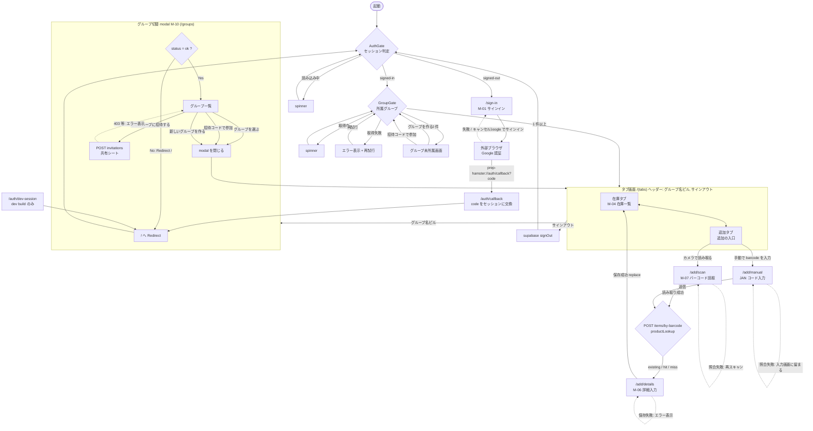

# 画面遷移図 v1.1.0（実装済み分）

> 本書は `apps/user/client/mobile/app` の現行コードから起こしたモバイルアプリの画面遷移図。計画（`docs/flow/v1.0.0/screen-flow.md`）との比較に使う。
> flow（流動）ドキュメント扱い。画面 ID（M-xx）は v1.0.0 の定義を引き継ぐ。

### 1. 実装済みの画面

- 対象は expo-router のファイル配置にある画面と、画面を持たない受け口（`auth/*`）
- 「到達方法」は画面に至る操作と、途中で通るゲートを書く

| ルート                 | 画面 ID | 内容                                                                                                                | 到達方法                                                                            |
| ---------------------- | ------- | ------------------------------------------------------------------------------------------------------------------- | ----------------------------------------------------------------------------------- |
| `/sign-in`             | M-01    | 「Google でサインイン」の 1 ボタン。失敗時は理由を表示                                                              | 起動時にセッションが無い、またはタブ側のゲートが未サインインと判定したとき          |
| `/auth/callback`       | 新規    | OAuth の戻り URL の受け皿。code があればセッションに交換して `/` へ戻す（画面は spinner のみ）                      | Google 認証後の `prep-hamster://auth/callback?code=...`（アプリが終了していた場合） |
| `/auth/dev-session`    | 新規    | dev build だけの受け口。token をセッションに設定して `/` へ戻す。本番 build では読まずに戻す                        | `prep-hamster://auth/dev-session?...`（自動テスト用）                               |
| `/(tabs)`（GroupGate） | 新規    | 所属グループの取得中は spinner、失敗なら理由と再試行、0 件なら作成・参加フォーム                                    | サインイン済みで `/` を開いたとき                                                   |
| `/(tabs)/index`        | M-04    | 在庫一覧（品名・場所・数量・期限）。プルで更新、タブ復帰で再取得。検索・絞り込みは無い                              | グループが決まったときの初期タブ、または保存後の `/(tabs)` への replace             |
| `/(tabs)/add`          | 新規    | 追加の入口。「カメラで読み取る」と「手動で barcode を入力 (debug)」の 2 択                                          | 下部タブの「追加」                                                                  |
| `/add/scan`            | M-07    | カメラ許可の確認、EAN-13 / EAN-8 の読み取り、商品の照会                                                             | 追加タブの「カメラで読み取る」                                                      |
| `/add/manual`          | 新規    | JAN コードを手で入力して照会する debug 入口。scan と同じ後続に乗る                                                  | 追加タブの「手動で barcode を入力 (debug)」                                         |
| `/add/details`         | M-06    | 保管場所・数量 / 単位・期限・メモを入れて保存。保管場所はその場で追加できる。照会が miss のときだけ品名を編集できる | scan または manual の照会成功（`router.replace`、itemId と productLookup を渡す）   |
| `/groups`（modal）     | M-10    | 所属グループの一覧と切替、招待コードの発行、招待コードで参加、新規作成                                              | ヘッダー左のグループ名ピル                                                          |

- タブ画面（在庫・追加）と M-10 を開くピル、サインアウトは、グループが決まったときだけヘッダーに出る
- サインアウトは独立した画面ではなく、タブのヘッダー右のボタン

### 2. 画面遷移図

- 菱形はリダイレクトを決めるゲート
- 点線はエラー時に同じ画面に留まる、または前の画面へ戻る遷移

### 3. 計画（v1.0.0）との差分

#### 3.1 未実装の画面

- M-03 ホーム: 期限が近い在庫サマリとクイックアクションは無い。起動後の最初の画面は在庫一覧（M-04）
- M-05 在庫詳細: 一覧の行は押せない。数量変更・消費・廃棄・編集の導線が無い
- M-08 通知一覧: 画面も push 通知の受け口も無い
- M-09 買い物リスト: 無い
- M-11 設定: 無い。サインアウトだけがタブのヘッダー右にある。サインアウトを設定に置く計画は `docs/design/supabase-auth.md` の「mobile のサインイン」節
- M-04 在庫一覧の機能: カテゴリ・場所での絞り込みと検索が無い
- M-07 バーコード読取の機能: 計画のローカルキャッシュ → ProductMaster → 外部 JAN API の三段フォールバックのうち、モバイルは API の `by-barcode` を 1 回呼ぶだけ。分岐の結果は `productLookup`（existing / hit / miss）で details に渡る
- オフライン動作: 全画面でオンライン前提。ローカルキューや参照キャッシュは無い（グループ選択の端末保存のみ）

#### 3.2 計画に無い画面

- `/(tabs)/add` 追加の入口: 計画はホームのクイックアクションからバーコード読取へ直行する。実装は下部タブの「追加」に入口を置き、カメラと手入力を選ばせる
- `/add/manual` JAN コードの手入力: 計画の M-06（手入力フォーム）とは別物。品名ではなくバーコードを手で入れる debug 入口で、カメラの使えない環境から scan と同じ後続に乗せる
- `/auth/callback`: OAuth の戻り URL の受け皿。画面ではなく spinner から `/` へ戻す中継
- `/auth/dev-session`: dev build だけの token 設定口。本番 build は何もせず `/` へ戻す
- グループ未所属画面（GroupGate 内）: グループを作る・招待コードで参加するフォーム。計画ではグループ作成は Web（W-03）に寄せていた。決定は `docs/design/mobile-groups.md`
- 取得中 spinner と取得失敗の再試行表示（GroupGate 内）

#### 3.3 フローが変わった箇所

- 認証: サインアップ（M-02）は作らず、Google の OAuth だけにした。サインイン後はブラウザで認証し、`prep-hamster://auth/callback` でアプリに戻る。決定は `docs/design/supabase-auth.md`（Apple は未実装）
- ゲート: 未サインインは `/sign-in` へ、サインイン済みで `/sign-in` を開くと `/` へ戻す（AuthGate）。グループが 0 件だとタブを出さない（GroupGate）
- グループ切替（M-10）: 計画のホーム上部のピルから、タブのヘッダー左のピルに移った。root の Stack の modal として開く。決定は `docs/design/mobile-groups.md`
- 招待: 計画は招待リンク（URL / QR）で、深リンクか短縮 URL + コードかが未確定だった。実装は M-10 の「このグループに招待する」で招待コードを発行し、共有シートで送る。受け取った側は「招待コードで参加」に貼る。深リンクは build を配るようになってから足す（`docs/design/mobile-groups.md` の「招待 (D-13)」節）。招待の発行は OWNER 以外 403 になる
- グループ作成・招待は計画では Web 管理画面（W-03 / W-05）の操作だったが、モバイルでもできる
- 保存後の遷移: 計画は在庫一覧（M-04）へ戻る。実装も `/(tabs)` へ replace し、タブ復帰で一覧を取り直す
- 保存の入力項目: 場所・数量 / 単位・使用期限 / 賞味期限・メモ。品名は照会が miss のときだけ編集でき、保存前に品目を PATCH する

### 4. フローに置けなかったもの

- `/add/*` は AuthGate を通らない。未サインインで deep link から開くと、サインイン画面へ回すゲートが無い（API 呼び出しの失敗として表示される）
- `/groups` は AuthGate ではなく、`status` が `ok` でなければ `/` へ Redirect する独自の判定。サインアウトや読み込み前に開かれた場合の入口戻し
- `/add/details` は `itemId` が無いと「itemId が指定されていません」を出して止まる（deep link 直打ちのとき）
- 画面遷移図は現行コードのルート定義から起こしたもの。`docs/design/screens-as-is.md` の遷移図は認証・グループ導入前のため、ここでは使っていない

---

## ステータス・更新履歴

- 2026-11-01: 初版作成（v1.1.0 ブランチ時点のモバイル実装から作成）
