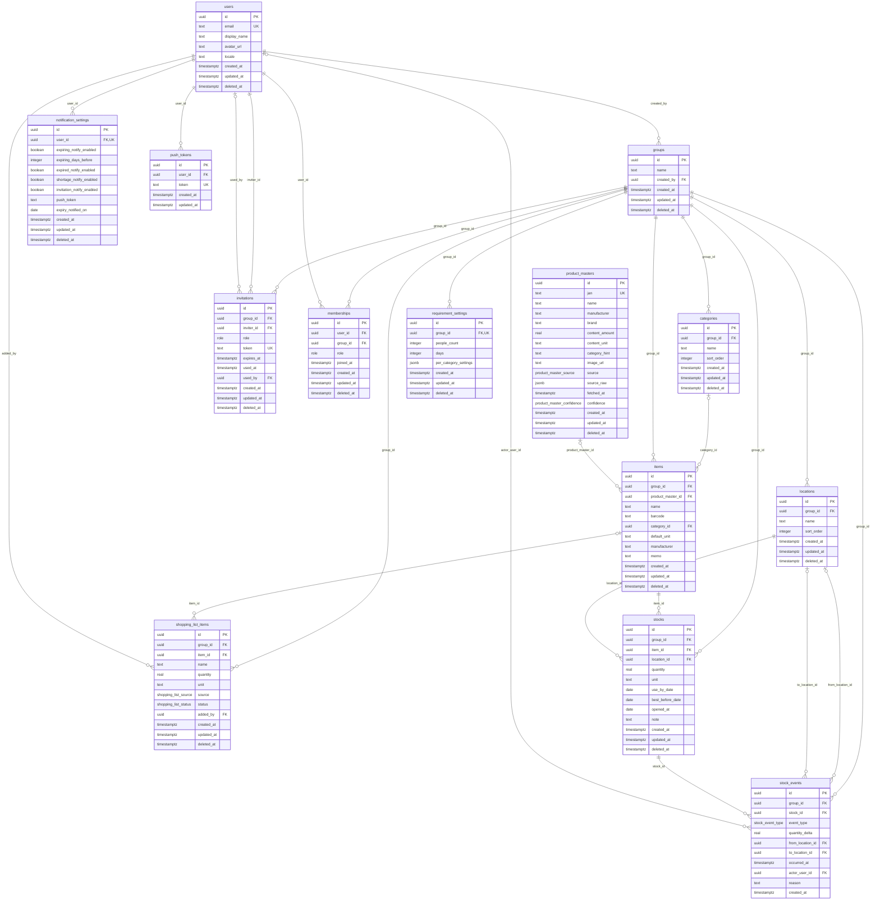

# Data model

> `packages/db/src/schema.ts` から `bun run docs:generate` (`packages/db/scripts/generate-er.ts`) で自動生成される。手で編集せず、スキーマを変えたら再生成する。
> v1.0.0 の設計時点の ER 図とエンティティ定義は `docs/flow/v1.0.0/data-model.md` に残っている (現在のスキーマとは一致しない)。

## ER 図

## Enum

| 名前                        | 値                                                                         |
| --------------------------- | -------------------------------------------------------------------------- |
| `product_master_confidence` | `HIGH`, `MEDIUM`, `LOW`                                                    |
| `product_master_source`     | `YAHOO_SHOPPING`, `RAKUTEN_ICHIBA`, `JANCODE_LOOKUP`, `GS1_JICFS`, `OTHER` |
| `role`                      | `OWNER`, `EDITOR`, `VIEWER`                                                |
| `shopping_list_source`      | `AUTO`, `MANUAL`                                                           |
| `shopping_list_status`      | `OPEN`, `BOUGHT`, `CANCELLED`                                              |
| `stock_event_type`          | `ADD`, `CONSUME`, `DISCARD`, `MOVE`, `EDIT`                                |

## テーブル

### `categories`

| カラム       | 型                         | NULL     | デフォルト | キー               |
| ------------ | -------------------------- | -------- | ---------- | ------------------ |
| `id`         | `uuid`                     | NOT NULL | —          | PK                 |
| `group_id`   | `uuid`                     | NOT NULL | —          | FK → `groups`.`id` |
| `name`       | `text`                     | NOT NULL | —          | —                  |
| `sort_order` | `integer`                  | NULL     | —          | —                  |
| `created_at` | `timestamp with time zone` | NOT NULL | `now()`    | —                  |
| `updated_at` | `timestamp with time zone` | NOT NULL | `now()`    | —                  |
| `deleted_at` | `timestamp with time zone` | NULL     | —          | —                  |

- FK `group_id` → `groups`.`id`

### `groups`

| カラム       | 型                         | NULL     | デフォルト | キー              |
| ------------ | -------------------------- | -------- | ---------- | ----------------- |
| `id`         | `uuid`                     | NOT NULL | —          | PK                |
| `name`       | `text`                     | NOT NULL | —          | —                 |
| `created_by` | `uuid`                     | NOT NULL | —          | FK → `users`.`id` |
| `created_at` | `timestamp with time zone` | NOT NULL | `now()`    | —                 |
| `updated_at` | `timestamp with time zone` | NOT NULL | `now()`    | —                 |
| `deleted_at` | `timestamp with time zone` | NULL     | —          | —                 |

- FK `created_by` → `users`.`id`

### `invitations`

| カラム       | 型                         | NULL     | デフォルト | キー               |
| ------------ | -------------------------- | -------- | ---------- | ------------------ |
| `id`         | `uuid`                     | NOT NULL | —          | PK                 |
| `group_id`   | `uuid`                     | NOT NULL | —          | FK → `groups`.`id` |
| `inviter_id` | `uuid`                     | NOT NULL | —          | FK → `users`.`id`  |
| `role`       | `role`                     | NOT NULL | —          | —                  |
| `token`      | `text`                     | NOT NULL | —          | UK                 |
| `expires_at` | `timestamp with time zone` | NOT NULL | —          | —                  |
| `used_at`    | `timestamp with time zone` | NULL     | —          | —                  |
| `used_by`    | `uuid`                     | NULL     | —          | FK → `users`.`id`  |
| `created_at` | `timestamp with time zone` | NOT NULL | `now()`    | —                  |
| `updated_at` | `timestamp with time zone` | NOT NULL | `now()`    | —                  |
| `deleted_at` | `timestamp with time zone` | NULL     | —          | —                  |

- FK `group_id` → `groups`.`id`
- FK `inviter_id` → `users`.`id`
- FK `used_by` → `users`.`id`

### `items`

| カラム              | 型                         | NULL     | デフォルト | キー                        |
| ------------------- | -------------------------- | -------- | ---------- | --------------------------- |
| `id`                | `uuid`                     | NOT NULL | —          | PK                          |
| `group_id`          | `uuid`                     | NOT NULL | —          | FK → `groups`.`id`          |
| `product_master_id` | `uuid`                     | NULL     | —          | FK → `product_masters`.`id` |
| `name`              | `text`                     | NOT NULL | —          | —                           |
| `barcode`           | `text`                     | NULL     | —          | —                           |
| `category_id`       | `uuid`                     | NULL     | —          | FK → `categories`.`id`      |
| `default_unit`      | `text`                     | NULL     | —          | —                           |
| `manufacturer`      | `text`                     | NULL     | —          | —                           |
| `memo`              | `text`                     | NULL     | —          | —                           |
| `created_at`        | `timestamp with time zone` | NOT NULL | `now()`    | —                           |
| `updated_at`        | `timestamp with time zone` | NOT NULL | `now()`    | —                           |
| `deleted_at`        | `timestamp with time zone` | NULL     | —          | —                           |

- FK `group_id` → `groups`.`id`
- FK `product_master_id` → `product_masters`.`id`
- FK `category_id` → `categories`.`id`
- INDEX `items_group_barcode_idx` (`group_id`, `barcode`) UNIQUE WHERE "items"."product_master_id" IS NULL AND "items"."barcode" IS NOT NULL
- INDEX `items_group_product_master_idx` (`group_id`, `product_master_id`) UNIQUE WHERE "items"."product_master_id" IS NOT NULL

### `locations`

| カラム       | 型                         | NULL     | デフォルト | キー               |
| ------------ | -------------------------- | -------- | ---------- | ------------------ |
| `id`         | `uuid`                     | NOT NULL | —          | PK                 |
| `group_id`   | `uuid`                     | NOT NULL | —          | FK → `groups`.`id` |
| `name`       | `text`                     | NOT NULL | —          | —                  |
| `sort_order` | `integer`                  | NULL     | —          | —                  |
| `created_at` | `timestamp with time zone` | NOT NULL | `now()`    | —                  |
| `updated_at` | `timestamp with time zone` | NOT NULL | `now()`    | —                  |
| `deleted_at` | `timestamp with time zone` | NULL     | —          | —                  |

- FK `group_id` → `groups`.`id`

### `memberships`

| カラム       | 型                         | NULL     | デフォルト | キー               |
| ------------ | -------------------------- | -------- | ---------- | ------------------ |
| `id`         | `uuid`                     | NOT NULL | —          | PK                 |
| `user_id`    | `uuid`                     | NOT NULL | —          | FK → `users`.`id`  |
| `group_id`   | `uuid`                     | NOT NULL | —          | FK → `groups`.`id` |
| `role`       | `role`                     | NOT NULL | —          | —                  |
| `joined_at`  | `timestamp with time zone` | NOT NULL | —          | —                  |
| `created_at` | `timestamp with time zone` | NOT NULL | `now()`    | —                  |
| `updated_at` | `timestamp with time zone` | NOT NULL | `now()`    | —                  |
| `deleted_at` | `timestamp with time zone` | NULL     | —          | —                  |

- FK `user_id` → `users`.`id`
- FK `group_id` → `groups`.`id`
- UNIQUE `memberships_user_group_unique` (`user_id`, `group_id`)
- INDEX `memberships_group_idx` (`group_id`)
- INDEX `memberships_user_idx` (`user_id`)

### `notification_settings`

| カラム                      | 型                         | NULL     | デフォルト | キー                  |
| --------------------------- | -------------------------- | -------- | ---------- | --------------------- |
| `id`                        | `uuid`                     | NOT NULL | —          | PK                    |
| `user_id`                   | `uuid`                     | NOT NULL | —          | FK → `users`.`id`, UK |
| `expiring_notify_enabled`   | `boolean`                  | NOT NULL | `true`     | —                     |
| `expiring_days_before`      | `integer`                  | NOT NULL | `7`        | —                     |
| `expired_notify_enabled`    | `boolean`                  | NOT NULL | `true`     | —                     |
| `shortage_notify_enabled`   | `boolean`                  | NOT NULL | `true`     | —                     |
| `invitation_notify_enabled` | `boolean`                  | NOT NULL | `true`     | —                     |
| `push_token`                | `text`                     | NULL     | —          | —                     |
| `expiry_notified_on`        | `date`                     | NULL     | —          | —                     |
| `created_at`                | `timestamp with time zone` | NOT NULL | `now()`    | —                     |
| `updated_at`                | `timestamp with time zone` | NOT NULL | `now()`    | —                     |
| `deleted_at`                | `timestamp with time zone` | NULL     | —          | —                     |

- FK `user_id` → `users`.`id`

### `product_masters`

| カラム           | 型                          | NULL     | デフォルト | キー |
| ---------------- | --------------------------- | -------- | ---------- | ---- |
| `id`             | `uuid`                      | NOT NULL | —          | PK   |
| `jan`            | `text`                      | NOT NULL | —          | UK   |
| `name`           | `text`                      | NOT NULL | —          | —    |
| `manufacturer`   | `text`                      | NULL     | —          | —    |
| `brand`          | `text`                      | NULL     | —          | —    |
| `content_amount` | `real`                      | NULL     | —          | —    |
| `content_unit`   | `text`                      | NULL     | —          | —    |
| `category_hint`  | `text`                      | NULL     | —          | —    |
| `image_url`      | `text`                      | NULL     | —          | —    |
| `source`         | `product_master_source`     | NOT NULL | —          | —    |
| `source_raw`     | `jsonb`                     | NULL     | —          | —    |
| `fetched_at`     | `timestamp with time zone`  | NOT NULL | —          | —    |
| `confidence`     | `product_master_confidence` | NULL     | —          | —    |
| `created_at`     | `timestamp with time zone`  | NOT NULL | `now()`    | —    |
| `updated_at`     | `timestamp with time zone`  | NOT NULL | `now()`    | —    |
| `deleted_at`     | `timestamp with time zone`  | NULL     | —          | —    |

- INDEX `product_masters_fetched_at_idx` (`fetched_at`)

### `push_tokens`

| カラム       | 型                         | NULL     | デフォルト | キー              |
| ------------ | -------------------------- | -------- | ---------- | ----------------- |
| `id`         | `uuid`                     | NOT NULL | —          | PK                |
| `user_id`    | `uuid`                     | NOT NULL | —          | FK → `users`.`id` |
| `token`      | `text`                     | NOT NULL | —          | UK                |
| `created_at` | `timestamp with time zone` | NOT NULL | `now()`    | —                 |
| `updated_at` | `timestamp with time zone` | NOT NULL | `now()`    | —                 |

- FK `user_id` → `users`.`id`
- INDEX `push_tokens_user_idx` (`user_id`)

### `requirement_settings`

| カラム                  | 型                         | NULL     | デフォルト | キー                   |
| ----------------------- | -------------------------- | -------- | ---------- | ---------------------- |
| `id`                    | `uuid`                     | NOT NULL | —          | PK                     |
| `group_id`              | `uuid`                     | NOT NULL | —          | FK → `groups`.`id`, UK |
| `people_count`          | `integer`                  | NOT NULL | —          | —                      |
| `days`                  | `integer`                  | NOT NULL | —          | —                      |
| `per_category_settings` | `jsonb`                    | NULL     | —          | —                      |
| `created_at`            | `timestamp with time zone` | NOT NULL | `now()`    | —                      |
| `updated_at`            | `timestamp with time zone` | NOT NULL | `now()`    | —                      |
| `deleted_at`            | `timestamp with time zone` | NULL     | —          | —                      |

- FK `group_id` → `groups`.`id`

### `shopping_list_items`

| カラム       | 型                         | NULL     | デフォルト | キー               |
| ------------ | -------------------------- | -------- | ---------- | ------------------ |
| `id`         | `uuid`                     | NOT NULL | —          | PK                 |
| `group_id`   | `uuid`                     | NOT NULL | —          | FK → `groups`.`id` |
| `item_id`    | `uuid`                     | NULL     | —          | FK → `items`.`id`  |
| `name`       | `text`                     | NOT NULL | —          | —                  |
| `quantity`   | `real`                     | NOT NULL | —          | —                  |
| `unit`       | `text`                     | NULL     | —          | —                  |
| `source`     | `shopping_list_source`     | NOT NULL | —          | —                  |
| `status`     | `shopping_list_status`     | NOT NULL | —          | —                  |
| `added_by`   | `uuid`                     | NOT NULL | —          | FK → `users`.`id`  |
| `created_at` | `timestamp with time zone` | NOT NULL | `now()`    | —                  |
| `updated_at` | `timestamp with time zone` | NOT NULL | `now()`    | —                  |
| `deleted_at` | `timestamp with time zone` | NULL     | —          | —                  |

- FK `group_id` → `groups`.`id`
- FK `item_id` → `items`.`id`
- FK `added_by` → `users`.`id`

### `stock_events`

| カラム             | 型                         | NULL     | デフォルト | キー                  |
| ------------------ | -------------------------- | -------- | ---------- | --------------------- |
| `id`               | `uuid`                     | NOT NULL | —          | PK                    |
| `group_id`         | `uuid`                     | NOT NULL | —          | FK → `groups`.`id`    |
| `stock_id`         | `uuid`                     | NOT NULL | —          | FK → `stocks`.`id`    |
| `event_type`       | `stock_event_type`         | NOT NULL | —          | —                     |
| `quantity_delta`   | `real`                     | NOT NULL | —          | —                     |
| `from_location_id` | `uuid`                     | NULL     | —          | FK → `locations`.`id` |
| `to_location_id`   | `uuid`                     | NULL     | —          | FK → `locations`.`id` |
| `occurred_at`      | `timestamp with time zone` | NOT NULL | —          | —                     |
| `actor_user_id`    | `uuid`                     | NULL     | —          | FK → `users`.`id`     |
| `reason`           | `text`                     | NULL     | —          | —                     |
| `created_at`       | `timestamp with time zone` | NOT NULL | `now()`    | —                     |

- FK `group_id` → `groups`.`id`
- FK `stock_id` → `stocks`.`id`
- FK `from_location_id` → `locations`.`id`
- FK `to_location_id` → `locations`.`id`
- FK `actor_user_id` → `users`.`id`
- INDEX `stock_events_group_occurred_idx` (`group_id`, `occurred_at`)
- INDEX `stock_events_stock_occurred_idx` (`stock_id`, `occurred_at`)

### `stocks`

| カラム             | 型                         | NULL     | デフォルト | キー                  |
| ------------------ | -------------------------- | -------- | ---------- | --------------------- |
| `id`               | `uuid`                     | NOT NULL | —          | PK                    |
| `group_id`         | `uuid`                     | NOT NULL | —          | FK → `groups`.`id`    |
| `item_id`          | `uuid`                     | NOT NULL | —          | FK → `items`.`id`     |
| `location_id`      | `uuid`                     | NOT NULL | —          | FK → `locations`.`id` |
| `quantity`         | `real`                     | NOT NULL | —          | —                     |
| `unit`             | `text`                     | NOT NULL | —          | —                     |
| `use_by_date`      | `date`                     | NULL     | —          | —                     |
| `best_before_date` | `date`                     | NULL     | —          | —                     |
| `opened_at`        | `date`                     | NULL     | —          | —                     |
| `note`             | `text`                     | NULL     | —          | —                     |
| `created_at`       | `timestamp with time zone` | NOT NULL | `now()`    | —                     |
| `updated_at`       | `timestamp with time zone` | NOT NULL | `now()`    | —                     |
| `deleted_at`       | `timestamp with time zone` | NULL     | —          | —                     |

- FK `group_id` → `groups`.`id`
- FK `item_id` → `items`.`id`
- FK `location_id` → `locations`.`id`
- INDEX `stocks_group_best_before_idx` (`group_id`, `best_before_date`)
- INDEX `stocks_group_item_idx` (`group_id`, `item_id`)
- INDEX `stocks_group_location_idx` (`group_id`, `location_id`)
- INDEX `stocks_group_use_by_idx` (`group_id`, `use_by_date`)
- CHECK `stocks_quantity_nonneg`: `"stocks"."quantity" >= 0`

### `users`

| カラム         | 型                         | NULL     | デフォルト | キー |
| -------------- | -------------------------- | -------- | ---------- | ---- |
| `id`           | `uuid`                     | NOT NULL | —          | PK   |
| `email`        | `text`                     | NOT NULL | —          | UK   |
| `display_name` | `text`                     | NOT NULL | —          | —    |
| `avatar_url`   | `text`                     | NULL     | —          | —    |
| `locale`       | `text`                     | NOT NULL | `ja-JP`    | —    |
| `created_at`   | `timestamp with time zone` | NOT NULL | `now()`    | —    |
| `updated_at`   | `timestamp with time zone` | NOT NULL | `now()`    | —    |
| `deleted_at`   | `timestamp with time zone` | NULL     | —          | —    |
